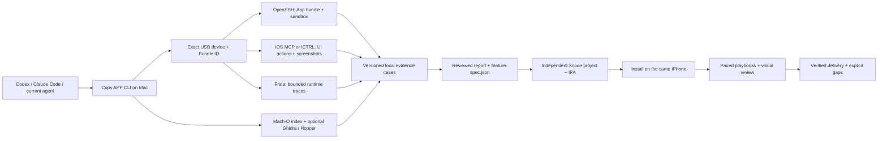
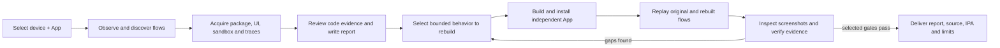

# Copy APP

English · [简体中文](README.zh-CN.md) · [繁體中文](docs/readme/README_zh-TW.md) · [日本語](docs/readme/README_ja.md) · [한국어](docs/readme/README_ko.md) · [Türkçe](docs/readme/README_tr.md) · [Русский](docs/readme/README_ru.md) · [Tiếng Việt](docs/readme/README_vi.md) · [ไทย](docs/readme/README_th.md) · [Deutsch](docs/readme/README_de.md) · [Español](docs/readme/README_es.md) · [Français](docs/readme/README_fr.md) · [Українська](docs/readme/README_uk.md) · [Polski](docs/readme/README_pl.md) · [Português (Brasil)](docs/readme/README_pt-BR.md) · [العربية](docs/readme/README_ar.md) · [فارسی](docs/readme/README_fa.md) · [Bahasa Indonesia](docs/readme/README_id.md) · [Italiano](docs/readme/README_it.md) · [Ελληνικά](docs/readme/README_el.md)

Copy APP is a local, evidence-gated workflow for analyzing an installed iOS app on a jailbroken iPhone and rebuilding selected behavior as an independent, runnable iOS app. It acquires package and sandbox evidence, inspects native code, captures UI and runtime behavior, produces a cited report and feature specification, then builds and compares a clone on the same device.

**Tested support:** The first-release core stages are verified on both iPhone XR / iOS 16.1.1 (rootless) and [iPhone 14 / iOS 17.3.1 (Relaxin/RootHide)](docs/relaxin-roothide-iphone14.md). Support here means the tested device setup can collect evidence, produce a reviewed report, install an independent App and verify named behavior on the same phone. It does not promise every App, jailbreak configuration or feature will work. iOS 26 has not been tested.

| Device status | Verified scope | Device-specific setup |
| --- | --- | --- |
| iPhone XR · iOS 16.1.1 · rootless | Deep analysis, encrypted App recovery, a three-flow original/clone fixture check with five reviewed screenshot pairs, current original/clone SQLite row checks, and fixture share-extension text receipt; selected original Translate input and Clock Stopwatch flows pass both UI backends | Rootless iOS MCP, SSH, host-matched Frida; TrollStore or valid signing for installation |
| iPhone 14 · iOS 17.3.1 · Relaxin/RootHide | Completed four-flow `copyapp copy` parent with reviewed Calculator report, original-App button traces, signed independent clone, four paired final-view assertions and five reviewed screenshot pairs; encrypted Remoboard recovery; fixture flows, SQLite checks and share-extension text receipt; selected original Translate input and Clock Stopwatch flows pass both UI backends | RootHide iOS MCP with ElleKit, mobile SSH, pinned Frida 17.23.3 sidecar, Apple Development signing for the clone; first-use setup for Translate/Clock |
| iPhone 11 · iOS 26.0.1 | Not tested | No setup or compatibility claim yet |

The earlier iOS 17 Calculator clone source and IPA existed before its report; a separate [new-source four-flow pilot](docs/ios17-calculator-fresh-from-report.md) now verifies report-guided implementation, signing, installation and paired comparison on that phone. Its installed RootHide Frida server cannot provide root `root-run`; the verified encrypted-package route uses mobile SSH. The [iOS 17 device record](docs/relaxin-roothide-iphone14.md) gives exact evidence and limits.

The [v0.1.12 release validation](docs/releases/v0.1.12.md) adds self-owned, exact-device SSH forwarding to standalone `acquire` and `sandbox` commands. Apple Podcasts package/static acquisition, sandbox indexing and three UI navigation flows passed on each phone. The prior [v0.1.11 release](docs/releases/v0.1.11.md) records bounded TrollStore timeout diagnostics and verified Clock build-5 upgrades on both phones; earlier timeout attempts remain failures.

The iOS 17 Podcasts first launch exposed a SpringBoard welcome gate; normal launch succeeded after onboarding. The selected checks do not establish a Podcasts deep report or rebuilt App. [Exact evidence and limits](docs/two-device-verification-matrix.md).

The [v0.1.10 release validation](docs/releases/v0.1.10.md) adds [stopped and running Clock state across relaunch on both phones](docs/clock-clone-two-device.md), plus in-use clone upgrades with exact-target preinstall termination. A [post-release one-minute background check](docs/clock-background-two-device.md) confirms continued visible Stopwatch progression in the clone on both phones. The [v0.1.9 release](docs/releases/v0.1.9.md) established the cross-device baseline and recorded the state-loss gap. The [v0.1.8 release](docs/releases/v0.1.8.md) records first-use gate diagnosis and four-way Translate/Clock checks.

The [two-device verification matrix](docs/two-device-verification-matrix.md) now also records the **same** Calculator `98→9` swipe script and Safari synthetic text-entry script through both iOS MCP and iCTRL on each phone, plus a completed one-flow `hopper-direct` analysis-to-rebuild parent on iOS 17. These bounded outcomes do not imply every field, gesture or App behaves identically.

Fresh v0.1.10 doctor cases found all tested device channels available on both phones. The published v0.1.10 wheel was downloaded again, matched the release SHA-256, and loaded from an isolated install. A [first-use gate check](docs/ios17-first-use-gates.md) found that iOS 17 Translate and Clock launch errors were accompanied by SpringBoard welcome screens; after their onboarding, both Apps entered their own foreground processes. The **same** Translate input and Clock Stopwatch scripts then passed through iOS MCP and iCTRL on both phones. On XR, the older Translate tap at `(207,320)` still fails to show text, while a tap near the placeholder at `(100,201)` shows the keyboard and succeeds. A same-script URLSession probe attached to Translate on both phones and saw zero task-resume events; a separate App Store Search-tab control captured positive events on both phones. The zero-event Translate result does not prove absence of network traffic. See the [matrix](docs/two-device-verification-matrix.md) for exact cases and limits.

A [standalone Codex CLI trial on the XR](docs/external-codex-xr-trial.md) completed a source-linked Calculator report, independent build and installation, and three paired behavior checks. It reused verified discovery scripts and earlier clone source; see the trial note for the exact scope.

## How it works

Copy APP has two deliverables: a **source-linked analysis report** and an **independent iOS app with measured coverage**. A coding agent can drive the workflow, but the CLI records and verifies the device observations behind its claims. The Mac does the orchestration and builds; the jailbroken iPhone supplies the installed App, UI and runtime evidence.



The device services have separate jobs. **OpenSSH** acquires the installed package and bounded sandbox evidence. **Frida** observes selected calls and can support the verified package recovery path. **iOS MCP** is the device tweak used for foreground identity, UI structure, screenshots and gestures; **iCTRL** is an optional XCTest-based UI backend. One backend performs a playbook's touches at a time. Ghidra and Hopper run on the Mac when selected; REA is not a runtime dependency. See the [workflow guide](docs/copy-workflow.md) for each stage and its inputs.



### Philosophy

- **Evidence before explanation.** A screenshot, trace or pseudocode fragment is an observation; a claim about how a feature works must link to evidence and say what remains unknown.
- **Measured scope.** “Copy” means implementing named, tested flows. A passing comparison does not imply full App equivalence or recovery of the original source.
- **Reproducible, local cases.** Cases pin the device, App, inputs, timestamps and hashes. Raw IPAs, screenshots, sandbox data and credentials stay in ignored local `cases/` rather than in Git.
- **Independent implementation.** Rebuilt Apps are new projects. We preserve upstream attribution for tools and source we adapt; we do not treat decompiler output as original source.
- **Replaceable tools.** The workflow can use either UI backend and optional native analyzers while keeping the same evidence and delivery gates. It runs without REA.

## How to contribute

Start with an issue or a focused pull request. Useful contributions include a reproducible device/backend bug, a bounded analysis adapter, a verified UI playbook, clearer setup instructions, and translations. Include the iOS version, jailbreak, tool versions, exact command, expected result and sanitized logs when reporting a device issue. Keep IPAs, credentials, account data and raw sandbox exports out of commits. Run `PYTHONPYCACHEPREFIX=/tmp/copyapp-pycache .venv/bin/python -m unittest discover -s tests` for code changes; verify any generated case with `copyapp verify`. For changes to a device path, describe the real-device evidence and remaining versions to test. The [contribution guide](CONTRIBUTING.md) has the checklist and repository map.

## Install and run your first survey

Copy APP is a **Mac command-line project plus services on your own jailbroken iPhone**. Start with the Mac CLI and one USB survey; that first result needs no phone-side Copy APP tweak, SSH, Frida, iCTRL or decompiler. Add those components only for deep analysis and rebuilding. The Mac bootstrap script below handles Python and CLI installation, but USB trust, phone permissions and jailbreak packages still need setup on the device. A full Xcode installation is needed for device developer services and building a rebuilt app. The files under `cases/` contain local device evidence and are Git-ignored, so the example case links later in this README exist only in the original test workspace.

If Codex or Claude Code is open in this repository, you can ask it: **“Set up Copy APP and run a first USB survey of the App on my connected iPhone.”** The agent can run the Mac commands and identify the exact device and Bundle ID; you still approve USB trust on the phone. A first survey is an initial observation, not the full reverse-engineering report.

| Goal | Set up now |
| --- | --- |
| First survey | Mac bootstrap, USB cable and phone trust. |
| Detailed analysis | Add phone OpenSSH and Frida, plus UI control. The documented XR path uses iOS MCP; iCTRL is optional. Ghidra and Hopper are optional. |
| Runnable rebuild | Add Xcode signing and a working install path: TrollStore, or USB InstallationProxy for a development-signed IPA. |

### 1. Install the Mac CLI

```sh
git clone https://github.com/everettjf/copyapp.git
cd copyapp
sh scripts/bootstrap-macos.sh
```

The script creates or reuses `.venv/`, installs Copy APP and prints the guided setup command. It requires macOS and Python 3.9 or newer. When you reach runtime tracing or encrypted App recovery, rerun `sh scripts/bootstrap-macos.sh --trace` to install host Frida. On the tested RootHide iOS 17 phone, run `copyapp setup frida-roothide` with pinned SSH credentials after installing host `frida==17.23.3`; it stages a matching official sidecar without replacing RootHide's Frida 16.1.4 package. See the [exact setup and limits](docs/relaxin-roothide-iphone14.md). Check `xcode-select -p` if you plan to use Xcode device services or build a clone; select a **full Xcode**, rather than only Command Line Tools. Keep `.venv/` and `cases/` on the Mac; neither is committed.

### 2. Connect and check one phone

On the phone, activate its compatible jailbreak, unlock it, connect it by USB, and accept **Trust This Computer**. Run the guided check:

```sh
.venv/bin/copyapp onboard
```

It selects the only USB device, creates a dedicated local SSH key if needed, checks Mac and phone channels, and saves an actionable report under `cases/onboard-.../report.md`. It opens a temporary USB SSH forward for its check, so no tunnel terminal is needed yet. It never installs phone packages or trusts an unverified SSH host key. The default `--stage survey` shows only first-survey repairs; rerun with `--stage analyze` or `--stage rebuild` for those goals. If several devices are connected, it prints their IDs and requires `--udid <UDID>`. Once the report says the first survey is ready, list Apps:

```sh
.venv/bin/copyapp apps --udid <UDID> --all
```

Replace `<UDID>` with the exact ID printed by `onboard`; never use a displayed phone name as the selector. `apps` lists user apps by default, while `--all` includes system apps. Resolve the target's exact Bundle ID before collecting anything. If no device appears, fix USB trust, unlocking and the cable first. On iOS 16, if screenshots or Instruments need developer services, enable Developer Mode and run `.venv/bin/pymobiledevice3 mounter auto-mount --udid <UDID>`; the report identifies unavailable observations.

### 3. Make a first USB-only case

Open the target App on the phone and leave it on the screen you want to inspect. This first survey needs no jailbreak-side Copy APP tweak, SSH or Frida:

```sh
.venv/bin/copyapp survey --udid <UDID> --bundle <BUNDLE_ID> \
  --ui-backend usb --out cases/first-survey
.venv/bin/copyapp verify cases/first-survey
```

Read `cases/first-survey/report.md` and its screenshot. This is an installation and device smoke test, not the deep analysis report. Use a new `--out` directory for each run; Copy APP preserves existing evidence rather than overwriting it.

You can stop here for a first impression. The remaining setup is for full package recovery, runtime evidence, richer UI control and real-device rebuild checks.

### 4. Add phone services for full analysis

First install host Frida if you have not already: `sh scripts/bootstrap-macos.sh --trace`. The phone-side steps below are one-time per device. `copyapp doctor` reports which channels are ready once they are configured.

The full pipeline needs the following channels on the **same UDID**:

| Component | Setup | Used for |
| --- | --- | --- |
| OpenSSH on the jailbroken phone | Install a rootless-compatible OpenSSH server; keep it reachable through the USB port forward below. | Read-only App bundle and sandbox acquisition. |
| Frida server on the phone | On ordinary rootless, install a host-matched server. On the tested RootHide/iOS 17 phone, use `copyapp setup frida-roothide` for the isolated 17.23.3 server. | Runtime method tracing and the ordinary rootless full-package helper route. RootHide's verified package helper route runs through paired mobile SSH. |
| Copy APP iOS MCP tweak | Build and install [`device/ios-mcp`](device/ios-mcp/README.md), then reload SpringBoard. | Foreground identity, UI tree, screenshots and gestures over a USB-forwarded localhost service. |
| iCTRL runner and paired Mac client | Run `copyapp setup ictrl --udid <UDID> --out cases/ictrl-setup` with a valid development-signed runner IPA or configured Xcode signing, then approve the phone's prompts. USB installation is tried first; TrollStore over SSH is the fallback. | Optional UI backend and fallback for an Instruments fresh-launch failure. |

For the tweak, the source build requires a complete Xcode, Theos, the iPhoneOS 16.5 SDK and `ldid`; the SDK and Theos are **not** vendored here. From the repository root, after installing those tools, run `THEOS=/path/to/theos CLANG_MODULE_CACHE_PATH=/private/tmp/copyapp-clang-modules make -C device/ios-mcp package`. Install the resulting `.deb` from `device/ios-mcp/packages/` with the phone's package manager or Filza, then reload SpringBoard. The XR/iOS 16 rootless package is tested. RootHide needs its own Theos fork, `THEOS_PACKAGE_SCHEME=roothide`, and an actual tweak loader such as ElleKit. [The iPhone 14 status note](docs/relaxin-roothide-iphone14.md) records a successful RootHide build, ElleKit installation and live UI service validation. The optional iCTRL source is pinned in [`vendor/ictrl`](vendor/ictrl/UPSTREAM.md) with its Apache 2.0 license and NOTICE; generated signing files, large build dependencies and pairing keys stay local.

Copy APP expects a dedicated `mobile` SSH key at `cases/ssh/id_ed25519` (created by `onboard` if absent) and a pinned host-key file at `cases/ssh-known-hosts`. For the one-time host-key check or interactive UI work, one command keeps both USB forwards running:

```sh
.venv/bin/copyapp tunnel --udid <UDID>
```

Use `--ssh-only` before installing the iOS MCP tweak if preferred. In the repository terminal, collect the phone's host key; run `ssh-keygen` only if you used `onboard --no-keygen`:

```sh
mkdir -p cases/ssh
ssh-keygen -t ed25519 -f cases/ssh/id_ed25519 -C copyapp
ssh-keyscan -p 22222 127.0.0.1 > cases/ssh-known-hosts
ssh-keygen -lf cases/ssh-known-hosts
```

Compare that fingerprint with the iPhone's SSH host-key fingerprint **before** accepting it; repeat this check for another phone. Add `cases/ssh/id_ed25519.pub` to the phone's `mobile` account `~/.ssh/authorized_keys` in the phone terminal, or use one initial password-authenticated SSH session after the fingerprint check:

```sh
cat cases/ssh/id_ed25519.pub | ssh -p 22222 \
  -o UserKnownHostsFile=cases/ssh-known-hosts \
  -o StrictHostKeyChecking=yes -o PubkeyAuthentication=no \
  mobile@127.0.0.1 'umask 077; mkdir -p ~/.ssh; cat >> ~/.ssh/authorized_keys; chmod 700 ~/.ssh; chmod 600 ~/.ssh/authorized_keys'
```

Enter the `mobile` password only at that prompt. Keep the private key on the Mac and do not put a phone password in a command or chat. If you chose a passphrase for the key, load it into `ssh-agent`: Copy APP uses noninteractive SSH authentication. Confirm the connection prints the same `<UDID>`:

```sh
ssh -p 22222 -i cases/ssh/id_ed25519 \
  -o UserKnownHostsFile=cases/ssh-known-hosts \
  -o StrictHostKeyChecking=yes mobile@127.0.0.1 'deviceinfo uniqueid'
```

To add the optional iCTRL UI backend, install `xcodegen` (`brew install xcodegen`) and configure an Apple Development signing team in Xcode, or supply an already signed runner IPA. `setup` builds the vendored Mac client and, unless an IPA was supplied, the signed XCTest runner. It applies the tested Xcode 27/iOS 16 outer-runner minimum-version adjustment before signing, tries USB InstallationProxy first, falls back to TrollStore over the paired SSH channel if needed, then opens a temporary USB tunnel and pairs it. On iOS 17+, it keeps an XCTest session active during setup and UI capture. The first build downloads iCTRL's pinned IDevice framework (about 215 MB). Approve the phone's XCTest and notification prompts and the matching pairing fingerprint. It does not save the pairing token in `cases/`:

```sh
.venv/bin/copyapp setup ictrl --udid <UDID> --out cases/first-ictrl-setup
.venv/bin/copyapp verify cases/first-ictrl-setup
.venv/bin/copyapp doctor --udid <UDID> --out cases/doctor-with-ictrl
```

If a compatible runner is already installed, `setup` reuses it and verifies the existing pairing. An already signed runner IPA can be supplied with `--runner-ipa <IPA>`; setup checks its Bundle ID and minimum iOS version before installation. Add `--reinstall` to replace an existing runner with that IPA. On iOS 17+, `--auto-approve-first-pair` instructs the development runner to approve one local USB pairing request. Use a new `--out` directory for retries. The vendored Xcode 27 build, `com.copyapp` migration and pairing passed on XR/iOS 16.1.1 and iPhone 14/iOS 17.3.1. An earlier iOS 17 screenshot call returned an empty response; the subsequent three-flow fixture replay through iCTRL completed with screenshots and verified evidence. iOS 26 remains untested. See [the iPhone 14 note](docs/relaxin-roothide-iphone14.md) and [the iCTRL XR notes](docs/ictrl-xr-validation.md).

Copy APP's iCTRL builds use team-scoped IDs: `com.copyapp.<team-id>.ictrl` for the optional settings app and `com.copyapp.<team-id>.ictrl.uitests.xctrunner` for the runner. The generated, ignored `vendor/ictrl/Config/Local.xcconfig` overrides the default; if upgrading an earlier upstream build, change its `ICTRL_BUNDLE_PREFIX` to `com.copyapp.<team-id>` or delete the file to regenerate it, then reinstall the runner. A new Bundle ID is a new app, so iOS may ask for notification permission and iCTRL pairing again. Approve the matching fingerprint and rerun `setup` with a new output directory if its first attempt times out. The old runner can be removed after the new ID passes authenticated health.

The vendored runtime's URL registration names, pairing-file type, dispatch queue labels and Keychain service also use `com.copyapp`. Current pairings persist in the sandbox file and survived the XR runner update; legacy pairings stored only in the old Keychain service need pairing again. The `ictrl://` and `ictrl-app://` URL schemes and the RPC protocol remain the same. Upstream identity and old device observations remain in the license/provenance and validation notes.

Then record a capability baseline:

```sh
.venv/bin/copyapp doctor --udid <UDID> --out cases/first-doctor
.venv/bin/copyapp verify cases/first-doctor
```

Read `cases/first-doctor/report.md`. Before a full analysis, `usb_lockdown`, `ssh_mobile`, `frida_usb` and `ios_mcp` should be `available`. `ictrl` is optional until selected as a backend. `doctor` can exit successfully when USB works even if another probe is unavailable; inspect its individual rows and ordered **Next steps**. `doctor` opens a temporary SSH forward when port `22222` is not running. `acquire --transport ssh`, `sandbox`, `analyze`, `prepare-app`, and the full `copy` workflow open and authenticate an exact-device SSH forward themselves; playbook replay opens its own short-lived UI tunnel. Rerun `onboard --udid <UDID> --stage analyze` into a new dated case after each setup stage.

With two phones connected, give each one its own pinned `--ssh-known-hosts` file and a distinct `--ssh-port`, and keep `--udid` explicit. A host-key mismatch is a stop condition: confirm which USB phone the forward reaches before trusting a new key. Do not replace one phone's saved host key with the other's. The release validation used separate XR and iPhone 14 pins; `doctor` now reports this case directly.

### 5. Run analysis, then choose decompilation and rebuild

For a first package/UI/sandbox analysis, open the target App or let the command launch it:

```sh
.venv/bin/copyapp analyze --udid <UDID> --bundle <BUNDLE_ID> \
  --launch --ui-backend ios-mcp --out cases/first-analysis
.venv/bin/copyapp verify cases/first-analysis
```

Read `cases/first-analysis/analysis.md`. It is a collection index, so a detailed functional report still needs controlled UI flows, function review and `copyapp report`. For an App Store binary with encrypted Mach-O files, prepare the pinned helper with `sh scripts/prepare-ipadecrypt-helper.sh` and add `--decrypt` to `analyze` or use the default full `copy` path; the helper is downloaded outside this repository under `../toolchains/`. Decrypted output is an **analysis IPA**, not an installable signed App. An App you compiled locally may already have `cryptid=0` and need no decryption. See [full-package recovery](docs/full-package-decryption.md).

Direct Ghidra or Hopper pseudocode is optional and requires a separately installed tool. Choose `--analysis-provider ghidra-direct --ghidra-dir <DIR> --java-home <JDK_HOME>` or `--analysis-provider hopper-direct` in the full workflow. Hopper also needs a licensed GUI session. For the rebuilt App, Xcode and a working signing/install path are required; the tested XR path uses an existing TrollStore installation. On iOS 17.3.1, an Apple Development signed Calculator clone installed through `copyapp install --transport usb`, with exact UDID, IPA hash, version/build and validated profile recorded in a verified case. The clone launched and passed one paired arithmetic flow on that device. Build the App with your Xcode development team, package its signed `.app` under `Payload/` in an IPA, then run:

```sh
.venv/bin/copyapp install --transport usb --udid <UDID> --ipa <SIGNED_IPA> --out cases/clone-install
.venv/bin/copyapp verify cases/clone-install
```

The USB route does not need TrollStore or SSH. `install` saves `input.ipa` inside its local case before transfer, so later builds cannot invalidate that case's package hash. When a paired iCTRL runner is configured, it requests termination of only the target Bundle ID; the XR TrollStore path also checks Frida process paths and each candidate's on-device `Info.plist` before stopping stale mobile processes. Save unsaved work in the target App before upgrading it. The two-phone tests cover versioned Clock upgrades while the old App was running. XR TrollStore timed out twice on an identical build and once on a versioned upgrade; the latter succeeded on retry from the saved IPA. On a TrollStore helper timeout, the case now retains bounded `device-run/output.txt`, records the process stop request, and probes InstallationProxy into `install.json` as `installed_after_timeout`; inspect those records before deciding whether a retry is safe. A stop request does not prove the helper or any child process has exited. Increment the App build number for an update and inspect InstallationProxy before retrying an uncertain result. A successful install does not yet establish that the App launched or matched the original; run paired UI flows afterward. Start the staged `copy` job below only after its required `doctor` channels work. The [workflow guide](docs/copy-workflow.md) explains every pause, report and device check.

| If setup stops here | Check |
| --- | --- |
| `devices` lists nothing | Unlock the phone, accept USB trust, change the cable or USB port, and rerun `devices`. |
| Screenshot or DVT is unavailable | Check Developer Mode, full Xcode selection and the device's Developer Disk Image; rerun `doctor` into a new directory. |
| `ssh_mobile` is unavailable | Keep the `22222 → 22` forward alive, check the pinned host key and `mobile` key login, then compare `deviceinfo uniqueid` with the chosen UDID. |
| `ios_mcp` is unavailable | Check that the rootless tweak loaded after SpringBoard reload. `analyze` opens its own exact-device UI forward; inspect `copyapp doctor` if the service remains unreachable. |
| `frida_usb` is unavailable | Check that Frida server is running on that phone and matches the installed host Frida version. |
| Fresh UI launch fails when Instruments is unavailable | Run `setup ictrl`, then check `doctor`'s `ictrl` row; on XR with Xcode 27, see the [iOS 16 compatibility trial](docs/ictrl-xr-validation.md). |

If a case fails, inspect its manifest and stage logs before retrying. `analyze` and the staged `copy` workflow accept `--resume` with their original arguments; a failed UI action may have changed App state, so check the screen before replaying it.

## Run the full Analyze → Rebuild workflow

From an active Codex or Claude Code session, use the current agent as the worker:

```sh
.venv/bin/copyapp copy \
  --udid <DEVICE_UDID> --bundle <ORIGINAL_BUNDLE_ID> \
  --auto-discover --agent-provider current \
  --project rebuild/<NEW_PROJECT> --rebuilt-bundle <NEW_BUNDLE_ID> \
  --out cases/<NEW_WORKFLOW_CASE>
```

The command first writes `<CASE>/discovery-agent/TASK.md` and pauses. The current agent observes the real app, writes 3–12 bounded UI playbooks, and runs `copyapp discover-check` against the specified device. Resume the same `copyapp copy` command with `--resume` after its discovery case verifies. Preparation then collects package, sandbox, UI, runtime and optional network evidence. The workflow pauses again for a formal analysis report and `analysis-delivery`, and once more for independent app implementation, installation, paired real-device comparison, screenshot review and `agent-delivery`. Each phase resumes only after its evidence passes verification. This mode never starts a nested coding-agent process.

If representative flows already exist, replace `--auto-discover` with repeated `--script <PLAYBOOK>` or `--discovery <VERIFIED_DISCOVERY_CASE>`. These options are mutually exclusive. An independent terminal may instead choose `--agent-provider codex` or `claude` for external CLI execution. The [standalone Codex CLI trial](docs/external-codex-xr-trial.md) passed selected Calculator report and rebuild gates using existing discovery scripts and clone source; unfamiliar-app autonomy and the Claude CLI path remain untested. Agent process exit alone is never accepted as a finished report or clone.

See [the workflow guide](docs/copy-workflow.md) for the exact handoffs, commands and evidence gates, or [its Chinese version](docs/copy-workflow.zh-CN.md). Agents working in this repository should follow [the Copy APP skill](skills/copyapp-copy/SKILL.md) and [repository guidance](AGENTS.md).

## Capabilities and evidence

| Stage | Available capability | Verified scope |
| --- | --- | --- |
| Device and UI | Exact USB device selection, screenshot, foreground identity, accessibility tree, bounded taps, stable screenshots | iPhone XR; iOS MCP and selected iCTRL paths |
| Acquisition | App package and sandbox metadata collection, full-package Mach-O recovery, source hashes | XR encrypted Kimi/DeepSeek; iPhone 14 RootHide encrypted Remoboard main App and keyboard extension |
| Native analysis | Mach-O and Objective-C indexing, Frida method/branch observations, bounded ARM64 inspection, direct Ghidra or Hopper pseudocode | XR Compass, Calculator, Clock, DeepSeek and a known-source fixture; integrated Hopper investigation on XR fixture and one complete Hopper-provider Calculator parent on iOS 17 |
| Report | Verified investigation cases, reviewed semantic report, feature specification, source-linked delivery | Selected, observed flows; function interpretations still require human or agent review |
| Rebuild | Independent Xcode project, real-device installation, paired flow replay, UIKit assertions, visual review and delivery | XR pilots with recorded minor visual differences |

The REA command and provider bridge has been removed. Choose `--analysis-provider ghidra-direct --ghidra-dir <DIR> --java-home <DIR>` or `--analysis-provider hopper-direct` for pseudocode. Hopper can be selected in `investigate-flow`, `investigate-app`, `prepare-analysis`, `prepare-app`, and `copy`; `--hopper-app <Hopper.app>` overrides the installed app location. Its `hopper-function` and `hopper-queue` commands also work independently. Hopper needs an installed, licensed GUI app in a normal macOS user session; a sandboxed launcher may fail its Spotlight lookup. On the iOS 16.1.1 XR, [one integrated Hopper investigation](cases/fixture-counter-hopper-investigation-v2-20261016/manifest.json) completed UI replay, Frida tracing, static candidate binding and decompilation; its evidence was imported into a [source-checked report](cases/fixture-counter-hopper-integrated-report-20261016/report.md). The bounded fresh launch falls back from Instruments to iCTRL lifecycle commands when Instruments fails. A [one-flow iOS 17 Hopper-provider `copy` parent](cases/ios17-hopper-current-parent-20261017/manifest.json) now verifies analysis, reviewed report and independent-App delivery. See [the standalone analysis boundary](docs/rea-independence.md) and [Hopper integration guide](docs/rea-hopper-integration.md).

A complete current-agent, three-flow Clock case is saved at [the XR workflow manifest](cases/clock-current-workflow-live-20261016/manifest.json). Its [reviewed report](cases/clock-current-workflow-live-20261016/analysis-agent/reviewed-report/report.md), [independent source](rebuild/ClockCurrentProbe) and [device delivery](cases/clock-current-workflow-live-20261016/rebuild-agent/agent-delivery/report.md) cover world-city selection, an unsaved alarm edit and stopwatch start/stop/reset. A second [XR auto-discovery parent](cases/clock-current-auto-workflow-20261016/manifest.json) now joins discovery, [formal report](cases/clock-current-auto-workflow-20261016/analysis-agent/reviewed-report/report.md), [independent source](rebuild/ClockCurrentAutoProbe) and [device delivery](cases/clock-current-auto-workflow-20261016/rebuild-agent/agent-delivery/report.md) in one verified case: 3/3 selected behavior and final-view checks passed; all 10 screenshot pairs were reviewed with minor differences and no major difference. This second run reused previously authored discovery scripts and adapted the earlier independent Clock implementation. It validates orchestration and selected-flow delivery, not autonomous script authoring, zero-shot source generation or whole-app equivalence.

A fresh [Calculator auto-discovery parent](cases/calculator-current-auto-workflow-20261016/manifest.json) now tests those missing current-agent handoffs on the XR. The current agent observed the real Calculator UI, wrote three new playbooks, retained failed discovery attempts, produced a [source-linked report](cases/calculator-current-auto-workflow-20261016/analysis-agent/reviewed-report/report.md), and wrote a new [UIKit clone](rebuild/CalculatorFreshProbe) from an empty project. The installed clone passed 3/3 paired behavior and terminal UIKit assertions for decimal addition (`0.3`), negative addition (`−7`) and percent (`0.5`). All three [screenshot pairs](cases/calculator-current-auto-workflow-20261016/rebuild-agent/visual-review-v2/report.md) were reviewed as minor differences, with none major; the [delivery](cases/calculator-current-auto-workflow-20261016/rebuild-agent/agent-delivery/report.md) and parent both verify. This is one selected-flow, current-agent result; it does not establish general discovery, external CLI autonomy or complete Calculator behavior.

An unfamiliar-app [Translate XR workflow](docs/translate-xr-workflow.md) ([中文](docs/translate-xr-workflow.zh-CN.md)) now completes the same current-agent chain without REA: three newly discovered flows, a reviewed [binary/UI/data report](cases/translate-current-workflow-20261016/analysis-agent/reviewed-report/report.md), a new [UIKit clone](rebuild/TranslateFreshProbe), installation and 3/3 paired real-device replays. Six screenshots were reviewed with minor differences, mainly icons and spacing. The tested behavior is text entry without translation submission, Favorites empty state and Conversation idle navigation; translation output, speech and camera behavior remain outside this result.

Other local XR pilots include [Compass](docs/compass-xr-analysis.md), [Calculator](docs/calculator-button-dispatch-xr.md), [DeepSeek](docs/deepseek-three-flow-xr-verification.md) and [Clock](cases/clock-six-flow-no-rea-reviewed-report-v8-20261015/report.md), plus a known-source fixture. The current roadmap is in [the English plan](PLAN.en.md); the full historical experiment log is in [the Chinese plan](PLAN.md).

## Verification and limits

```sh
.venv/bin/copyapp devices
.venv/bin/copyapp apps --udid <DEVICE_UDID> --all
.venv/bin/copyapp verify cases/<CASE>
.venv/bin/python -m unittest discover -s tests
```

`apps` lists user-installed apps by default. `--all` also lists system apps, including Calculator, Compass and Clock on the tested XR, so a target named by its display name can be resolved to an exact Bundle ID.

Playbooks now support bounded swipes, long presses and double taps through both iOS MCP and iCTRL. The [gesture guide](docs/ui-gesture-playbooks.md) ([中文](docs/ui-gesture-playbooks.zh-CN.md)) gives the syntax, backend differences and XR evidence. iOS MCP 0.1.4 is installed on the XR and advertises all three actions. Calculator's observed `98→9` display swipe now passes on the independent clone too; the three earlier arithmetic flows passed again on the updated clone. Long press and double tap were verified as callable without claiming a specific app response.

Playbooks also support bounded [text entry](docs/ui-text-playbooks.md) ([中文](docs/ui-text-playbooks.zh-CN.md)). The XR [Translate discovery case](cases/translate-xr-discovery-20261016/manifest.json) originally used iCTRL because a lower tap left iOS MCP input invisible. A new script taps the visible placeholder; the keyboard and exact synthetic text now appear through both UI backends on both phones. Separate Safari checks pass through both backends too; see the [matrix](docs/two-device-verification-matrix.md). Input RPC success alone remains insufficient evidence.

Formal reports now render a bounded Assets.car name list and a metadata-only sandbox summary when those indexes exist. A [deeper Calculator report](cases/calculator-ui-deep-report-20261016/report.md) and its [source-linked analysis delivery](cases/calculator-ui-deep-analysis-delivery-20261016/report.md) verify these appendices and add direct Ghidra evidence for the root view, keypad frame layout and result-view gesture setup. Resource names and storage-looking filenames are investigation leads, not evidence of runtime use; the three arithmetic flows did not exercise the display gestures.

`copyapp verify` checks recorded source links and file hashes. For a standalone `install.json` directory, it also rechecks the saved IPA hash, Bundle ID and version; that does not prove the App is still installed now. A matching hash does not prove that a decompiler interpretation is correct or that an app is functionally equivalent. Store raw IPA files, screenshots, sandbox snapshots, traces and credentials only in ignored local `cases/`. Reports should distinguish direct observations, inferences and unknown behavior.

The current gaps are general discovery and independent implementation across unfamiliar apps, a real Claude CLI end-to-end run, broader app behavior and backend semantics, and full sandbox and network interpretation. The iOS 17.3.1 iPhone 14 has passed USB, iCTRL, SSH/static acquisition, iOS MCP, development-signed clone installation, encrypted Remoboard recovery, and original Calculator Frida tracing through the version-pinned sidecar. Its [reviewed Calculator report](cases/iphone14-calculator-frida17-deep-report-v3-20261017/report.md) and [selected-flow delivery](cases/iphone14-calculator-frida17-agent-delivery-20261017/report.md) verify one arithmetic flow. The new known-source fixture check adds three paired flows and five manually reviewed screenshot pairs on each of iOS 16 and iOS 17; see the [release validation](docs/releases/v0.1.2.md). These cases do not establish report-to-source generation for every App. The installed RootHide Frida server spawns commands as `mobile` (effective UID 501), so `root-run` rejects them; package recovery uses the verified mobile SSH helper path. Broader App coverage and iOS 26 remain unverified.

## Documentation

- [End-to-end workflow](docs/copy-workflow.md) · [中文](docs/copy-workflow.zh-CN.md)
- [UI gesture playbooks](docs/ui-gesture-playbooks.md) · [中文](docs/ui-gesture-playbooks.zh-CN.md)
- [UI text entry](docs/ui-text-playbooks.md) · [中文](docs/ui-text-playbooks.zh-CN.md)
- [Translate XR full workflow](docs/translate-xr-workflow.md) · [中文](docs/translate-xr-workflow.zh-CN.md)
- [Implementation plan](PLAN.en.md) · [中文及详细试验记录](PLAN.md)
- [REA independence](docs/rea-independence.md)
- [Copy APP agent skill](skills/copyapp-copy/SKILL.md)
- [Repository agent instructions](AGENTS.md)
- [Full Chinese README and historical evidence links](README.zh-CN.md)

## Acknowledgements

Copy APP builds on the work of these projects. Thank you to their maintainers and contributors.

**Source included or adapted in this repository:**

- [witchan/ios-mcp](https://github.com/witchan/ios-mcp) provides the basis for the adapted, rootless [iOS MCP tweak](device/ios-mcp/README.md). Its MIT license and NOTICE are retained.
- [OpenMinis/iCTRL](https://github.com/OpenMinis/iCTRL) provides the vendored XCUITest runner, companion app and encrypted client. The [pinned source and modifications](vendor/ictrl/UPSTREAM.md) retain its Apache-2.0 license and NOTICE.
- [morluto/rea](https://github.com/morluto/rea) informed the direct Ghidra scripts. Its [MIT license](docs/third-party/REA-LICENSE.txt) is retained; the current workflow does not require REA to run.

**Tools and components used by the workflow or the XR trials:**

- [pymobiledevice3](https://github.com/doronz88/pymobiledevice3) and [OpenSSH](https://www.openssh.com/) provide USB device services, port forwarding and authenticated file transfer.
- [londek/ipadecrypt](https://github.com/londek/ipadecrypt) supplies the pinned full-package decryption helper, fetched outside this repository. [Frida](https://frida.re/) supplies runtime tracing and device-side instrumentation.
- [Ghidra](https://github.com/NationalSecurityAgency/ghidra) and [Hopper](https://www.hopperapp.com/) provide optional, separately installed decompilers; Hopper requires a license.
- [Theos](https://github.com/theos/theos), [ldid](https://github.com/ProcursusTeam/ldid), [XcodeGen](https://github.com/yonaskolb/XcodeGen) and [Apple Xcode/XCTest](https://developer.apple.com/xcode/) support tweak, runner and rebuilt-app builds. [jkcoxson/idevice](https://github.com/jkcoxson/idevice) is fetched for iCTRL's device-image component.
- [TrollStore](https://github.com/opa334/TrollStore) installs the tested runner and rebuilt IPAs; the tested XR uses the [Dopamine](https://github.com/opa334/Dopamine) jailbreak. [Pillow](https://github.com/python-pillow/Pillow) supports image processing and visual comparisons.
