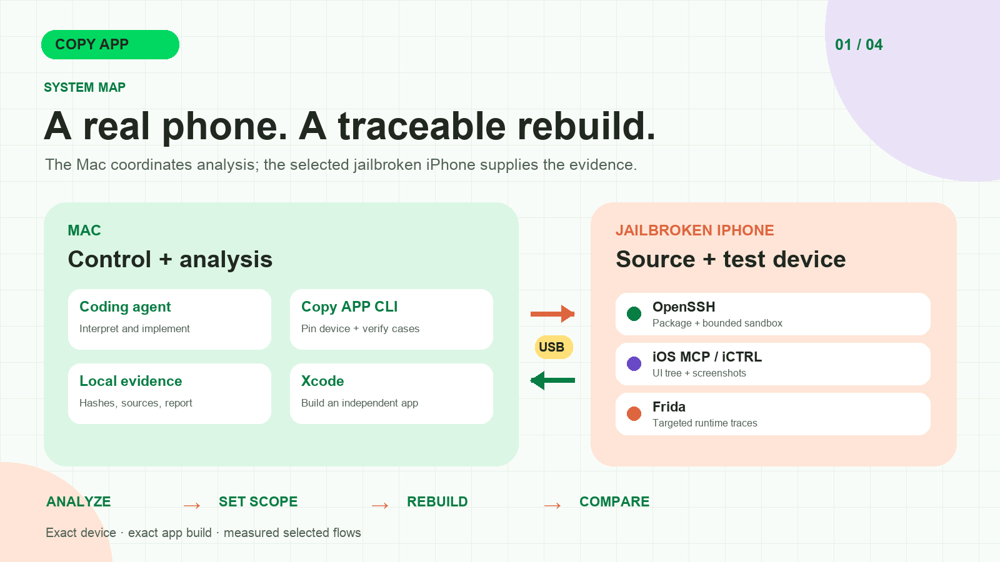

# Copy APP

English · [简体中文](README.zh-CN.md) · [繁體中文](docs/readme/README_zh-TW.md) · [日本語](docs/readme/README_ja.md) · [한국어](docs/readme/README_ko.md) · [Türkçe](docs/readme/README_tr.md) · [Русский](docs/readme/README_ru.md) · [Tiếng Việt](docs/readme/README_vi.md) · [ไทย](docs/readme/README_th.md) · [Deutsch](docs/readme/README_de.md) · [Español](docs/readme/README_es.md) · [Français](docs/readme/README_fr.md) · [Українська](docs/readme/README_uk.md) · [Polski](docs/readme/README_pl.md) · [Português (Brasil)](docs/readme/README_pt-BR.md) · [العربية](docs/readme/README_ar.md) · [فارسی](docs/readme/README_fa.md) · [Bahasa Indonesia](docs/readme/README_id.md) · [Italiano](docs/readme/README_it.md) · [Ελληνικά](docs/readme/README_el.md)

[Project website](https://xnu.app/copyapp/) · [Illustrated overview (简体中文)](docs/articles/copyapp-overview.zh-CN.md) · [Documentation](docs/README.md) · [Published release](docs/releases/v0.1.2.md) · [Contributing](CONTRIBUTING.md) · [Apache-2.0 license](LICENSE)

Copy APP analyzes an installed iOS app on a jailbroken iPhone and helps a coding agent build an **independent, runnable iOS app** that reproduces a reviewed set of behaviors. It collects package, sandbox, UI and runtime evidence; produces a source-linked report and feature specification; then checks the new app against the original on the same phone. The current release is **v0.1.2**.

Development branch: [macOS support through ChatComputer](docs/macos-support.md) is being added alongside iOS. Its [acceptance ledger](docs/macos-implementation-plan.md) distinguishes implemented foundations from pending end-to-end validation; published v0.1.2 remains the iOS release.

Mac examples: [owned behavior fixture](examples/macos/BehaviorFixture/) and
[independent Stocks demo](examples/macos/Stocks/) (selected local behavior;
illustrative offline data, with live acceptance limits recorded).

For a **Mac App** task on this branch, ask your agent to read `AGENTS.md` and `skills/copyapp-mac/SKILL.md`. Use the [Mac agent prompt](docs/macos-support.md#start-with-an-agent); the iPhone prompt below continues to use the existing iOS workflow.

<a id="start-here"></a>

## Start here: give the task to Codex or Claude Code

Open **Codex or Claude Code with local command execution on your Mac**, then connect and unlock your jailbroken iPhone over USB. Paste this request into the agent conversation and replace the app name. You do not need to know its Bundle ID.

```text
Use https://github.com/everettjf/copyapp to analyze and rebuild “APP NAME” on my USB-connected jailbroken iPhone.
Clone the project into a new directory if needed, or work in its existing checkout.
Read AGENTS.md and skills/copyapp-start/SKILL.md first. Check and configure the environment, identify the exact phone and app, then complete analysis, independent implementation, device installation and same-device comparison.
Execute the steps you can perform yourself. Tell me the specific action only when you need phone-side confirmation or missing target information. Deliver the report, runnable project, verified behavior and remaining differences.
Use docs/fidelity.md: target grade 80/100, at most three implementation/check cycles including the first. Stop when the target is met or the cycle budget is exhausted; disclose any unmet target and remaining differences.
```

The agent reads the repository's [first-use skill](skills/copyapp-start/SKILL.md) and follows the analysis, rebuild and verification workflows. **You do not need to type every CLI command below or install a provider-specific extension first.** The agent checks and configures the Mac; phone trust, initial permissions and signing access may still require your participation.

For analysis only, change the first sentence to “Analyze …; do not rebuild it in this task.” For a connection check, ask it to stop after a verified USB survey. See [first-run agent tasks](docs/first-run-agent.md) for more examples, or use the [manual CLI entry](#manual-installation-and-first-survey) if you prefer.

Development default: **80/100 reviewed fidelity grade, three cycles**. Ask for 70
for a quick prototype or 90 for finer detail. Core selected behavior must pass;
remaining visual differences stay explicit. This grade is separate from objective
image similarity and known-capability coverage. The [bounded workflow](docs/fidelity.md)
uses `fidelity-plan --fidelity 80 --max-iterations 3`; historical strict delivery
and standalone parent workflows retain their existing rules.

## Architecture at a glance



The Mac coordinates the coding agent, evidence and build; the selected iPhone supplies app files and observations. See the [detailed architecture and evidence model](docs/architecture.md).

## What the workflow delivers

1. **Analyze:** identify the exact phone and app build; inspect the installed package, Mach-O images, dependencies, classes, resources and bounded sandbox metadata; capture selected screens, actions and runtime traces; review a report with evidence IDs, implementation hypotheses and explicit unknowns.
2. **Rebuild:** choose a milestone from a known-capability inventory; implement an independent Xcode project; build, sign and install it; replay the same selected flows in both apps; review each screenshot pair and report measured coverage and gaps.

A small app may justify a broad first milestone. A complex app needs a named slice of behavior; a percentage is meaningful only with an explicit known-capability denominator. A passing selected-flow check does not establish whole-app equivalence. See [coverage targets](docs/coverage-targets.md).

The Mac runs orchestration and builds. OpenSSH acquires files, iOS MCP provides jailbroken UI observation and control, iCTRL is an optional XCTest-based UI backend, and Frida provides bounded runtime evidence. Ghidra and Hopper are optional native-analysis tools. **REA is not required.** The [architecture guide](docs/architecture.md) explains the trust and evidence boundaries.

The [example projects](examples/README.md) are under `examples/rebuild/`; `rebuild/<NEW_PROJECT>` in the commands below is a workspace for your own new output.

### Evidence, comparison and deliverables


These are workflow illustrations and selected public observations. The Calculator comparison covers one named flow and still has visible differences; the Hopper excerpt depicts saved evidence, not recovered source code. See the [device evidence and limits](docs/current-status.md).

## Tested support on current `main`

These are named-device, selected-flow results, not a compatibility promise for every iOS device or app. [Current evidence and limitations](docs/current-status.md) records the v0.1.2 scope and remaining gaps.

| Phone | Jailbreak and verified scope | Open limits |
| --- | --- | --- |
| iPhone XR · iOS 16.1.1 | Dopamine rootless; SSH, Frida, iOS MCP and iCTRL; selected Notes, Calculator, Translate and Clock analysis/rebuild paths | Optional developer file listing can return `ConnectionTerminatedError`; the SSH package/sandbox route works. |
| iPhone 14 · iOS 17.3.1 | Relaxin/RootHide; original Calculator acquisition, Frida trace and four original/independent-app arithmetic checks through iOS MCP | v0.1.2 fixes the v0.1.1 iCTRL session-lifetime fault; two runs of four paired flows passed. Reboot durability and the changed cleanup on other devices remain untested. |
| iPhone 11 · iOS 26.0.1 | Relaxin/RootHide; original Calculator and Clock analysis, signed independent apps and selected paired arithmetic/Stopwatch checks | iOS MCP can return a black frame after fresh launch; bounded Home/relaunch recovery passed observed runs. |

Current limitations include incomplete app coverage, modest visual differences, unverified reboot/rejailbreak durability, and no end-to-end onboarding test on a second physical Mac. Raw IPAs, complete case screenshots, sandbox contents and credentials stay in Git-ignored local `cases/` and are never release assets; the few Calculator images in the docs were selected separately for publication.

## Manual installation and first survey

These commands are for readers using the CLI directly; an agent executes them for you. The first USB survey needs Python 3.9+, an unlocked USB-connected iPhone, and **Trust This Computer** accepted. This stage needs no phone tweak, SSH, Frida or Xcode signing.

```sh
git clone https://github.com/everettjf/copyapp.git
cd copyapp
sh scripts/bootstrap-macos.sh
.venv/bin/copyapp onboard
.venv/bin/copyapp apps --udid <UDID> --all
```

Open the target app on the phone, confirm its exact Bundle ID, then collect and verify:

```sh
.venv/bin/copyapp survey --udid <UDID> --bundle <BUNDLE_ID> \
  --ui-backend usb --out cases/first-survey
.venv/bin/copyapp verify cases/first-survey
```

Read `cases/first-survey/report.md` and use a new output directory for each retry. Deep analysis also needs OpenSSH, an exact-device SSH route, the Copy APP iOS MCP tweak and a compatible Frida service; add iCTRL as needed. Rebuilding requires full Xcode and signing access or TrollStore. Use `onboard --stage analyze` and `doctor --udid <UDID>` to check readiness, then follow the [full setup guide](docs/setup.md) and [Analyze → Rebuild workflow](docs/copy-workflow.md).

## Run the full Analyze → Rebuild workflow

From an active Codex or Claude Code session:

```sh
.venv/bin/copyapp copy \
  --udid <UDID> --bundle <ORIGINAL_BUNDLE_ID> \
  --auto-discover --agent-provider current \
  --project rebuild/<NEW_PROJECT> --rebuilt-bundle <NEW_BUNDLE_ID> \
  --out cases/<WORKFLOW_CASE>
```

The command pauses for reviewed discovery scripts, a formal analysis report, and an independent implementation. Resume with the same arguments plus `--resume` after each verified handoff. `current` uses the agent already in this session; it does not launch a nested agent. Use `--agent-provider codex` or `claude` for a separate CLI process. Existing flows can be supplied with `--discovery <CASE>` or repeated `--script <FILE>` instead of `--auto-discover`. The [workflow guide](docs/copy-workflow.md) documents the gates and commands.

## Philosophy and contribution

Keep raw observations separate from interpretation. Tie material claims to a device, app build and verifiable source. Record failed attempts and uncertainty. Compare original and rebuilt apps from equivalent states, and report the behavior actually checked. Keep upstream credits and licenses with vendored components. Contributions that improve setup, bounded analysis, reproducible device checks, accessibility, or translations are welcome; see [CONTRIBUTING.md](CONTRIBUTING.md).

## License

Copy APP's project-owned code and documentation are licensed under the [Apache License 2.0](LICENSE). Vendored and adapted third-party material retains its own license and attribution: [iOS MCP](device/ios-mcp/LICENSE) is MIT-licensed, [iCTRL](vendor/ictrl/LICENSE) is Apache-2.0, and the retained [REA license](docs/third-party/REA-LICENSE.txt) is MIT. The project license does not replace those notices.

## Acknowledgements

Copy APP uses or draws on [witchan/ios-mcp](https://github.com/witchan/ios-mcp), [OpenMinis/iCTRL](https://github.com/OpenMinis/iCTRL), [Frida](https://frida.re/), [pymobiledevice3](https://github.com/doronz88/pymobiledevice3), [londek/ipadecrypt](https://github.com/londek/ipadecrypt), [Ghidra](https://github.com/NationalSecurityAgency/ghidra), and optional [Hopper](https://www.hopperapp.com/). Its optional direct Hopper interface was informed by MIT-licensed REA code; the license is retained in [docs/third-party/REA-LICENSE.txt](docs/third-party/REA-LICENSE.txt). See the vendored iCTRL [source record](vendor/ictrl/UPSTREAM.md), license and notice for the precise attribution and local changes.
