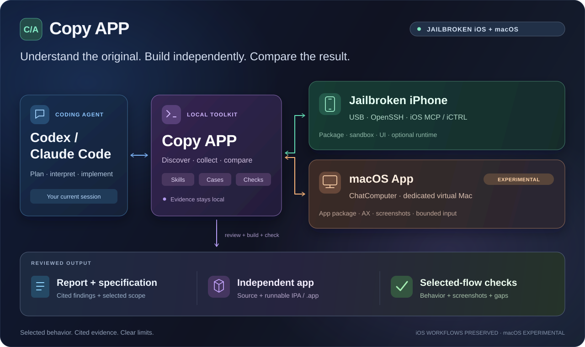
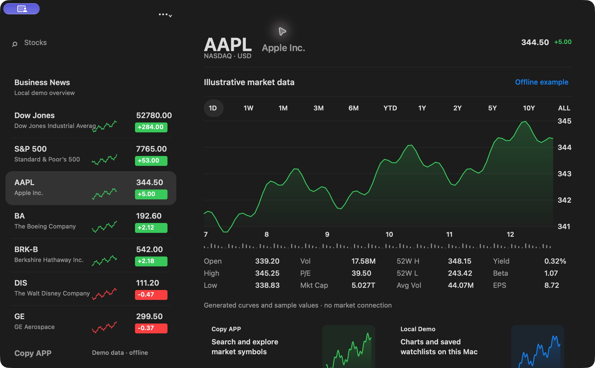
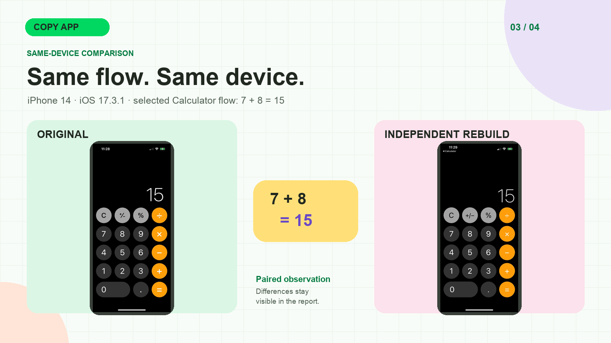

# Copy APP

[English](README.md) · 简体中文 · [繁體中文](docs/readme/README_zh-TW.md) · [日本語](docs/readme/README_ja.md) · [한국어](docs/readme/README_ko.md) · [Türkçe](docs/readme/README_tr.md) · [Русский](docs/readme/README_ru.md) · [Tiếng Việt](docs/readme/README_vi.md) · [ไทย](docs/readme/README_th.md) · [Deutsch](docs/readme/README_de.md) · [Español](docs/readme/README_es.md) · [Français](docs/readme/README_fr.md) · [Українська](docs/readme/README_uk.md) · [Polski](docs/readme/README_pl.md) · [Português (Brasil)](docs/readme/README_pt-BR.md) · [العربية](docs/readme/README_ar.md) · [فارسی](docs/readme/README_fa.md) · [Bahasa Indonesia](docs/readme/README_id.md) · [Italiano](docs/readme/README_it.md) · [Ελληνικά](docs/readme/README_el.md)

[项目网站](https://xnu.app/copyapp/) · [图文介绍](docs/articles/copyapp-overview.zh-CN.md) · [文档目录](docs/README.zh-CN.md) · [逆向工具](docs/reverse-engineering-tools.zh-CN.md) · [最新版本](docs/releases/v0.2.0.zh-CN.md) · [参与贡献](CONTRIBUTING.zh-CN.md) · [Apache-2.0 许可证](LICENSE)

Copy APP 帮助 Codex 或 Claude Code **分析已安装 App，并独立实现选定行为**，支持 **越狱 iOS 和 macOS**。结论、源码与对照结果保留可复查的证据来源。当前正式版本为 **v0.2.0**。[v0.1.2](docs/releases/v0.1.2.zh-CN.md) 为上一版仅支持 iOS 的版本。

**第一次使用？** [选 iOS 或 macOS，复制任务给 Agent](#从这里开始)。依赖检查和本地工具安装交给 Agent，设备信任与系统授权按提示完成。

开发分支新增[普通 iPhone UI 优先模式与可选主机包工具](docs/ios-standard-mode.zh-CN.md)。已测 iOS 26 样本使用重启后越狱未激活的手机。本轮约定的开发测试已完成；真实凭据的离线恢复及交叉核对已移至 [TODO](TODO.md)，命名设备的支持边界仍明确保留。

| 目标 | 使用方式 | 状态 |
| --- | --- | --- |
| 越狱 iOS | USB 真机、OpenSSH、iOS MCP／iCTRL，按需使用 Frida | 保留已测 iOS 16／17／26 工作流 |
| macOS | Apple Silicon Mac 上的 ChatComputer、独立虚拟 Mac 和有界 App／AX 采集器 | 已记录指定流程、恢复与实体 Mac 复验 |

Mac 行为报告不代表深层函数分析或任意 Mac 兼容。详见 [Mac 安装与 AI 任务](docs/macos-support.zh-CN.md)和[验收账本](docs/macos-implementation-plan.md)。

源码示例：[Stocks AppKit 示例](examples/macos/Stocks/)（明确标注的离线数据）、[独立编辑器](examples/macos/IndependentEditor/)、[自有样例](examples/macos/BehaviorFixture/)及 [iOS 示例](examples/rebuild/)。

## 架构一览



Mac 协调 Coding Agent、证据与构建；目标可以是通过 USB 连接的越狱 iPhone，也可以是 ChatComputer 中的独立虚拟 Mac。两个平台使用各自的命令与准确环境身份。组件边界和证据关系见[详细架构说明](docs/architecture.zh-CN.md)。

<a id="从这里开始"></a>

## 快速上手：选平台，复制一个任务

1. 在 Mac 上打开**能执行本地命令的 Codex 或 Claude Code**。
2. 选择下面的目标平台，把任务中的 **App 名称**换成自己的目标。
3. 复制任务给 Agent。它检查依赖、安装仓库 CLI，并读取对应 Skill；你按提示完成设备信任和系统授权。

保留源码检出：CLI、Skill、设备组件和示例都在仓库里。**无需安装某个专属 Agent 扩展。**

| 目标 | 你需要准备 | Agent 安装与检查 |
| --- | --- | --- |
| 越狱 iOS | Mac、USB 连接并解锁的越狱 iPhone，目标 App 已装在手机上 | Python 3.9+、仓库 CLI、准确手机／App，再按设备配置 SSH、界面／运行时工具和签名路线 |
| macOS | 满足 ChatComputer 要求的宿主 Mac；完成虚拟 Mac 初始化和必要授权；目标 App 在客体中可用 | Python 3.9+、仓库 CLI、Swift／macOS SDK、ChatComputer、客体采集器和准确环境／App 身份 |

### 越狱 iOS

连接并解锁手机。不知道 Bundle ID 也没关系，Agent 会识别。复制：

```text
请使用 https://github.com/everettjf/copyapp，分析并独立复刻 USB 连接的越狱 iPhone 上「App 名称」的选定行为。
需要时克隆到新目录，或复用已有检出。先阅读 AGENTS.md 和 skills/copyapp-start/SKILL.md。
检查 Python 3.9+；仓库 CLI 未安装时执行 sh scripts/bootstrap-macos.sh。识别准确的手机和 App，先完成 USB 首次检查，再按这台设备配置分析／复刻需要的依赖。
在当前 Agent 会话完成报告审阅、独立实现、安装与同机对照。需要手机信任、系统授权或签名条件时，告诉我具体操作。
在 output/ 下建立唯一任务目录，分开 project/ 和 evidence/。按 docs/fidelity.md 执行：默认 80 分，最多三轮实现／检查，首轮计入；达标或轮数耗尽就停止，交付源码、可运行产物、已验证范围与剩余差异。
```

只检查安装，可在任务末尾加：**“完成经校验的 USB survey，告诉我准确手机、App 和剩余依赖后停止，先不分析或复刻。”** 只想分析，则加**“交付审阅后的报告，先不复刻。”**

首次使用可能需要你在手机上确认**信任此电脑**、核对 SSH 指纹、授予权限，以及提供签名条件。宿主 CLI 安装不会替手机越狱或自动装好手机服务。详见 [iOS 安装指南](docs/setup.zh-CN.md)。

### macOS 与 ChatComputer

截至 **2026-10-22**，[ChatComputer 官方要求](https://github.com/chatcomputer/chatcomputer#install)为 **Apple Silicon、macOS 27、至少 16GB 内存和约 70GB 可用空间**。Copy APP 另需 Python 3.9+ 和可用的 Swift／macOS SDK；构建 Xcode 工程需要完整 Xcode。Agent 会先检查这些条件。

ChatComputer 可通过 `brew install --cask chatcomputer/tap/chatcomputer` 安装，也可从官方 Release 下载并把 `ChatComputer.app` 放入“应用程序”。[Mac 安装步骤](docs/macos-support.zh-CN.md#安装与首次使用)说明两种方式、命令可用性和客体授权。可以直接让 Agent 完成安装：

```text
请使用 https://github.com/everettjf/copyapp 和 ChatComputer，分析并独立复刻 macOS 上「App 名称」的选定行为。
需要时克隆到新目录，或复用已有检出。先阅读 AGENTS.md、skills/copyapp-mac/SKILL.md 和 docs/macos-support.zh-CN.md。
检查宿主是否满足 ChatComputer 当前要求，以及 Python 3.9+、Swift／macOS SDK。需要时运行 sh scripts/bootstrap-macos.sh 安装仓库 CLI，并从官方渠道安装 ChatComputer。
引导我完成虚拟 Mac 初始化及必要系统授权。执行 .venv/bin/copyapp mac doctor，部署有界采集器并登记准确客体；确认目标 App 已安装在虚拟 Mac 中，识别准确构建后再分析。
在当前 Agent 会话完成流程发现、报告审阅和实现。新 App 分开安装，对照相同流程并逐张审阅截图。保留 iOS 支持，不启动另一个 Agent 或 ChatComputer 内置模型循环。
在 output/ 下建立唯一任务目录，分开 project/ 和 evidence/。按 docs/fidelity.md 执行：默认 80 分，最多三轮实现／检查，首轮计入；达标或轮数耗尽就停止，交付源码、可运行产物、已验证范围与剩余差异。
```

**目标 App 要在虚拟 Mac 内可用。** 首次运行需完成客体初始化，以及 ChatComputer／采集器所需的录屏、辅助功能等授权。当前 Agent 已有自己的模型配置，这条工作流不要求再启动 ChatComputer 内置聊天模型。

只想检查安装，可在任务末尾加：**“完成经校验的环境登记和一次目标 App 截图／AX 观察后停止，先不分析或复刻。”** 只想分析，改成**“交付审阅后的行为报告，先不复刻。”** doctor 通过只代表传输和截图可用，不代表完整配置或 App 已验收。

[完整 Mac 安装指南](docs/macos-support.zh-CN.md) · [iOS 首次运行任务](docs/first-run-agent.zh-CN.md) · [源码示例](examples/README.md)

### 两个平台的默认设置

Agent 默认 **80 分、最多三轮**；快速原型可选 70，精细复刻可选 90。核心选定行为须通过，
其余视觉差异明确保留，不再无限打磨。该分数与客观图像相似度、已知能力覆盖率分开。
[有界复刻流程](docs/fidelity.md)使用 `fidelity-plan --fidelity 80 --max-iterations 3`；
旧严格交付和独立父工作流仍保留原验收语义。

## 支持的反编译与逆向工具

**已直接接入 Ghidra 和 Hopper 两种反编译器。** 二者按需启用，默认分析 provider 为 `none`。

| 工具 | 用途 | 入口／依赖 |
| --- | --- | --- |
| **Ghidra** | 指定函数伪代码、有界调用关系与指令引用 | `ghidra-function`、`ghidra-queue`、`ghidra-indirect`／`ghidra-direct`；外部 Ghidra + 匹配 JDK |
| **Hopper** | 指定函数伪代码与候选队列 | `hopper-function`、`hopper-queue`／`hopper-direct`；本机许可与 macOS 图形会话 |
| **Frida** | 方法命中、选定入口与有界寄存器运行观察 | `trace`、`experiment`、`flow-capture --method`；匹配的宿主／手机服务 |
| **LLVM／Xcode** | 有界 ARM64 反汇编与直接调用跟随 | `native-disasm`、`native-queue`；`llvm-objdump` |
| **内置 Mach-O／Objective-C** | 安装包、加载命令、类、selector 和方法地址 | `ipa`、`objc`；Mac 包另用 `mac inspect`／`mac acquire` |
| **ipadecrypt／恢复流程** | 在已验证 iOS 路线上恢复加密分析副本 | `decrypt-package`、`analyze --decrypt`；按设备准备环境 |

原生调查与报告接入主要服务现有 **iOS 工作流**。macOS 当前以 App 包、AX 和界面证据为主，尚未接成等价的原生函数链。**不依赖 REA 运行**；IDA Pro、Binary Ninja、radare2 暂无直接适配器。

[安装条件、provider 选择与 Agent 任务](docs/reverse-engineering-tools.zh-CN.md) · [Hopper 直连](docs/rea-hopper-integration.zh-CN.md)

## 两项交付

1. **分析：**固定手机和 App 版本；检查安装包、Mach-O、依赖库、类、资源和有界沙盒元数据；采集选定界面、操作与运行轨迹；审阅带证据 ID、实现推断和未知项的报告。
2. **复刻：**依据已知能力清单选定阶段目标；实现独立 iOS 或 macOS App，构建并安装 IPA 或 `.app`；在指定手机或虚拟 Mac 对照相同流程，逐图审阅并报告实际覆盖与差异。

简单 App 可以设较完整的阶段目标。复杂 App 应先选定有用的功能范围；只有明确已知能力的分母，百分比才有意义。选定流程通过不代表整 App 等价。详见[覆盖目标方法](docs/coverage-targets.zh-CN.md)。

Mac 负责编排和构建。OpenSSH 采集文件，iOS MCP 提供越狱环境下的界面观察与控制，iCTRL 是可选的 XCTest 界面后端，Frida 用于有界运行时取证。Ghidra 和 Hopper 是可选的本机代码分析工具，**不依赖 REA 运行**。详见[架构说明](docs/architecture.zh-CN.md)。

[示例工程](examples/README.md)分别位于 `examples/rebuild/`（iOS）和 `examples/macos/`（Mac）。新任务默认写入 `output/`，原有 `rebuild/<NEW_PROJECT>` 工作目录仍受支持。

### 看一个运行中的 macOS 示例



[Stocks 源码示例](examples/macos/Stocks/)实现股票搜索、图表周期切换和本地自选列表。上图是独立构建后在宿主 Mac 上的实际窗口截图，数值为离线演示数据；不是 Apple 原版 Stocks，也不提供实时行情。源码目录附构建步骤，历史客体对照结果与剩余视觉／行为差异另见[验收账本](docs/macos-implementation-plan.md)。

### 证据、对照与交付





这些图说明工作流和经过筛选的公开观察。Calculator 对照仅覆盖一条指定流程，仍有视觉差异；Hopper 片段展示保存的证据，并非恢复出的原始源码。详见[真机证据与限制](docs/current-status.zh-CN.md)。

## iOS 实测范围

以下结论只适用于指定手机和选定流程，不保证任意设备或 App 兼容。[当前状态](docs/current-status.zh-CN.md)记录 v0.1.2 的范围及剩余问题。

| 手机 | 越狱方式与已测范围 | 当前限制 |
| --- | --- | --- |
| iPhone XR · iOS 16.1.1 | Dopamine rootless；SSH、Frida、iOS MCP 与 iCTRL；Notes、Calculator、Translate 和 Clock 的选定分析／复刻路径 | 可选的开发者文件列表可能报 `ConnectionTerminatedError`；SSH 包／沙盒采集可用。 |
| iPhone 14 · iOS 17.3.1 | Relaxin/RootHide；原版 Calculator 采集、Frida 跟踪，以及经 iOS MCP 完成四条原版／独立 App 运算对照 | v0.1.2 修复 v0.1.1 的 iCTRL 会话故障，两轮各四条成对流程通过；重启及其他设备上的新清理逻辑仍待复验。 |
| iPhone 11 · iOS 26.0.1 | Relaxin/RootHide；Calculator、Clock 原版分析、签名独立 App 和选定运算／秒表成对检查 | iOS MCP 新启动后可能得到黑帧；已观察的故障经有界返回主屏／重启恢复。 |

尚未证明整 App 功能覆盖、无视觉差异、重新越狱后的长期稳定，或第二台实体 Mac 的全新配置。原始 IPA、完整案例截图、沙盒内容和凭据只保存在被 Git 忽略的本地目录（案例为 `cases/` 或任务 `output/`，凭据沿用原存储），不作为发布附件；文档中的少量 Calculator 示意画面经过单独筛选。

## 手动安装与首次采集

以下是给手动使用 CLI 的读者准备的入口。通过 Agent 使用时，它会执行这些步骤。第一次 USB 采集需要 Python 3.9+、已解锁并连接的 iPhone，以及手机上的“信任此电脑”；这个阶段无需 tweak、SSH、Frida 或 Xcode 签名。

```sh
git clone https://github.com/everettjf/copyapp.git
cd copyapp
sh scripts/bootstrap-macos.sh
.venv/bin/copyapp onboard
.venv/bin/copyapp apps --udid <UDID> --all
```

在手机上打开目标 App，确认准确的 Bundle ID，再采集并校验：

```sh
.venv/bin/copyapp survey --udid <UDID> --bundle <BUNDLE_ID> \
  --ui-backend usb --out cases/first-survey
.venv/bin/copyapp verify cases/first-survey
```

阅读 `cases/first-survey/report.md`，每次重试使用新的输出目录。完整分析还需 OpenSSH、精确设备 SSH 路由、Copy APP iOS MCP tweak 和兼容的 Frida 服务；iCTRL 按需加入。复刻另需完整 Xcode、签名团队或 TrollStore。用 `onboard --stage analyze` 和 `doctor --udid <UDID>` 检查就绪情况，按[完整安装指南](docs/setup.zh-CN.md)及[分析到复刻工作流](docs/copy-workflow.zh-CN.md)继续。

## 运行完整分析到复刻流程

在当前 Codex 或 Claude Code 会话中执行：

```sh
.venv/bin/copyapp copy \
  --udid <UDID> --bundle <ORIGINAL_BUNDLE_ID> \
  --auto-discover --agent-provider current \
  --rebuilt-bundle <NEW_BUNDLE_ID>
```

新任务默认写入工作区的 `output/<Bundle ID>-<UTC 时间>-<唯一编号>/`：
`project/` 放独立源码，`evidence/` 放报告、截图及检查结果。
可用 `--output-dir output/my-job` 自定义任务目录，也保留原有的
`--project <源码目录> --out <案例目录>`。路径须位于所选工作区内
（可用 `--workspace <目录>`）；仓库根目录的 `output/` 已被 Git 忽略，现有示例和案例不移动。
续跑时固定命令打印的 `--output-dir`（或原有 `--out`、`--project`），
其余设置保持相同，再加 `--resume`；不会自动猜测最近一次任务。

命令会在流程发现、正式分析报告和独立实现三个环节暂停，等待当前 Agent 完成并校验交付；每次用原参数加 `--resume` 续跑。`current` 不会启动嵌套 Agent。独立 CLI 进程可选 `--agent-provider codex` 或 `claude`。若已有流程，可用 `--discovery <CASE>` 或重复的 `--script <FILE>` 替代 `--auto-discover`。命令与门槛见[工作流指南](docs/copy-workflow.zh-CN.md)。

## 项目理念与贡献

把原始观察与解释分开。重要结论绑定设备、App 构建和可校验来源；保留失败尝试和未知项。原版与复刻版应从可比状态对照，只报告真正测过的行为。保留所用上游项目的署名和许可证。欢迎改进安装体验、有界分析、可重现真机检查、无障碍支持和翻译；见[贡献指南](CONTRIBUTING.zh-CN.md)。

## 许可证

Copy APP 自有代码和文档采用 [Apache License 2.0](LICENSE)。仓库中引用或改造的第三方材料保留各自的许可和署名：[iOS MCP](device/ios-mcp/LICENSE) 为 MIT，[iCTRL](vendor/ictrl/LICENSE) 为 Apache-2.0，保留的 [REA 许可证](docs/third-party/REA-LICENSE.txt)为 MIT。项目主许可证不会替代这些上游声明。

## 致谢

Copy APP 使用或参考 [ChatComputer](https://github.com/chatcomputer/chatcomputer)、[witchan/ios-mcp](https://github.com/witchan/ios-mcp)、[OpenMinis/iCTRL](https://github.com/OpenMinis/iCTRL)、[Frida](https://frida.re/)、[pymobiledevice3](https://github.com/doronz88/pymobiledevice3)、[londek/ipadecrypt](https://github.com/londek/ipadecrypt)、[Ghidra](https://github.com/NationalSecurityAgency/ghidra) 和可选的 [Hopper](https://www.hopperapp.com/)。Hopper 直连接口曾参考 MIT 许可的 REA 实现，许可证保存在 [docs/third-party/REA-LICENSE.txt](docs/third-party/REA-LICENSE.txt)。iCTRL 的准确来源、许可和本地改动见[上游记录](vendor/ictrl/UPSTREAM.md)。
