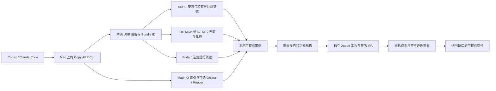

# Copy APP

[English](README.md) · 简体中文 · [繁體中文](docs/readme/README_zh-TW.md) · [日本語](docs/readme/README_ja.md) · [한국어](docs/readme/README_ko.md) · [Türkçe](docs/readme/README_tr.md) · [Русский](docs/readme/README_ru.md) · [Tiếng Việt](docs/readme/README_vi.md) · [ไทย](docs/readme/README_th.md) · [Deutsch](docs/readme/README_de.md) · [Español](docs/readme/README_es.md) · [Français](docs/readme/README_fr.md) · [Українська](docs/readme/README_uk.md) · [Polski](docs/readme/README_pl.md) · [Português (Brasil)](docs/readme/README_pt-BR.md) · [العربية](docs/readme/README_ar.md) · [فارسی](docs/readme/README_fa.md) · [Bahasa Indonesia](docs/readme/README_id.md) · [Italiano](docs/readme/README_it.md) · [Ελληνικά](docs/readme/README_el.md)

[项目网站](https://xnu.app/copyapp/) · [文档目录](docs/README.zh-CN.md) · [已发布版本](docs/releases/v0.1.0.zh-CN.md) · [参与贡献](CONTRIBUTING.zh-CN.md)

Copy APP 对越狱 iPhone 上已安装的 iOS App 取证分析，并协助 Coding Agent 创建**独立、可运行的 iOS App**，复现经过审阅的一组功能。它采集安装包、沙盒、界面和运行时证据，生成有来源引用的报告与功能规格，再在同一台手机上对照原版和新 App。当前正式发布版只有 **v0.1.0**；`main` 中已有后续开发成果，但尚未发布下一个版本。

## 从这里开始

首次 USB 概览需要一台装有 Python 3.9+ 的 Mac、已解锁并通过 USB 连接的 iPhone，以及手机上已点“信任此电脑”。这个阶段无需 tweak、SSH、Frida 或 Xcode 签名。

```sh
git clone https://github.com/everettjf/copyapp.git
cd copyapp
sh scripts/bootstrap-macos.sh
.venv/bin/copyapp onboard
.venv/bin/copyapp apps --udid <UDID> --all
```

在手机上打开目标 App，从列表确认准确的 Bundle ID，然后执行：

```sh
.venv/bin/copyapp survey --udid <UDID> --bundle <BUNDLE_ID> \
  --ui-backend usb --out cases/first-survey
.venv/bin/copyapp verify cases/first-survey
```

阅读 `cases/first-survey/report.md`。每次重试使用新的输出目录。需要深入分析和可运行复刻时，继续按[完整安装指南](docs/setup.zh-CN.md)及[分析到复刻流程](docs/copy-workflow.zh-CN.md)操作。也可以把[首次运行任务](docs/first-run-agent.zh-CN.md)交给当前仓库中的 Codex 或 Claude Code。

## 两项交付

1. **分析：**固定手机和 App 版本；检查安装包、Mach-O、依赖库、类、资源和有界沙盒元数据；采集选定界面、操作与运行轨迹；审阅带证据 ID、实现推断和未知项的报告。
2. **复刻：**依据已知能力清单选定阶段目标；实现独立 Xcode 工程；构建、签名、安装；在原版与复刻版重放同一组流程，逐张审阅截图并报告实际覆盖与差异。

简单 App 可以设较完整的阶段目标。复杂 App 应先选定有用的功能范围；只有明确已知能力的分母，百分比才有意义。选定流程通过不代表整 App 等价。详见[覆盖目标方法](docs/coverage-targets.zh-CN.md)。



Mac 负责编排和构建。OpenSSH 采集文件，iOS MCP 提供越狱环境下的界面观察与控制，iCTRL 是可选的 XCTest 界面后端，Frida 用于有界运行时取证。Ghidra 和 Hopper 是可选的本机代码分析工具，**不依赖 REA 运行**。详见[架构说明](docs/architecture.zh-CN.md)。

## 当前 `main` 的实测范围

以下结论只适用于指定手机和选定流程，不保证任意设备或 App 兼容。[当前状态](docs/current-status.zh-CN.md)区分了 v0.1.0 发布基线和后续 `main` 验证。

| 手机 | 越狱方式与已测范围 | 当前限制 |
| --- | --- | --- |
| iPhone XR · iOS 16.1.1 | Dopamine rootless；SSH、Frida、iOS MCP 与 iCTRL；Notes、Calculator、Translate 和 Clock 的选定分析／复刻路径 | 可选的开发者文件列表可能报 `ConnectionTerminatedError`；SSH 包／沙盒采集可用。 |
| iPhone 14 · iOS 17.3.1 | Relaxin/RootHide；原版 Calculator 采集、Frida 跟踪，以及经 iOS MCP 完成四条原版／独立 App 运算对照 | 额外的 iCTRL 复刻版多步重放返回 `malformed HTTP response`，稳定性仍待处理。 |
| iPhone 11 · iOS 26.0.1 | Relaxin/RootHide；Calculator、Clock 原版分析、签名独立 App 和选定运算／秒表成对检查 | iOS MCP 新启动后可能得到黑帧；已观察的故障经有界返回主屏／重启恢复。 |

尚未证明整 App 功能覆盖、无视觉差异、重新越狱后的长期稳定，或第二台实体 Mac 的全新配置。原始 IPA、截图、沙盒内容和凭据只保存在被 Git 忽略的本地 `cases/`，不作为发布附件。

## 安装与首次概览

[从这里开始](#从这里开始)的命令安装 CLI 并完成第一次 USB 采集。完整分析还需手机上的 OpenSSH、精确设备 SSH 路由、Copy APP iOS MCP tweak 和兼容的 Frida 服务；iCTRL 可按需加入。可运行复刻另需完整 Xcode、签名团队或 TrollStore，以及安装路径。[安装指南](docs/setup.zh-CN.md)列出了步骤和不同系统的分支。运行 `copyapp onboard --stage analyze` 与 `copyapp doctor --udid <UDID>` 查看各通道状态；USB 探针成功不等于全部服务就绪。

## 运行完整分析到复刻流程

在当前 Codex 或 Claude Code 会话中执行：

```sh
.venv/bin/copyapp copy \
  --udid <UDID> --bundle <ORIGINAL_BUNDLE_ID> \
  --auto-discover --agent-provider current \
  --project rebuild/<NEW_PROJECT> --rebuilt-bundle <NEW_BUNDLE_ID> \
  --out cases/<WORKFLOW_CASE>
```

命令会在流程发现、正式分析报告和独立实现三个环节暂停，等待当前 Agent 完成并校验交付；每次用原参数加 `--resume` 续跑。`current` 不会启动嵌套 Agent。独立 CLI 进程可选 `--agent-provider codex` 或 `claude`。若已有流程，可用 `--discovery <CASE>` 或重复的 `--script <FILE>` 替代 `--auto-discover`。命令与门槛见[工作流指南](docs/copy-workflow.zh-CN.md)。

## 项目理念与贡献

把原始观察与解释分开。重要结论绑定设备、App 构建和可校验来源；保留失败尝试和未知项。原版与复刻版应从可比状态对照，只报告真正测过的行为。保留所用上游项目的署名和许可证。欢迎改进安装体验、有界分析、可重现真机检查、无障碍支持和翻译；见[贡献指南](CONTRIBUTING.zh-CN.md)。

## 致谢

Copy APP 使用或参考 [witchan/ios-mcp](https://github.com/witchan/ios-mcp)、[OpenMinis/iCTRL](https://github.com/OpenMinis/iCTRL)、[Frida](https://frida.re/)、[pymobiledevice3](https://github.com/doronz88/pymobiledevice3)、[londek/ipadecrypt](https://github.com/londek/ipadecrypt)、[Ghidra](https://github.com/NationalSecurityAgency/ghidra) 和可选的 [Hopper](https://www.hopperapp.com/)。Hopper 直连接口曾参考 MIT 许可的 REA 实现，许可证保存在 [docs/third-party/REA-LICENSE.txt](docs/third-party/REA-LICENSE.txt)。iCTRL 的准确来源、许可和本地改动见[上游记录](vendor/ictrl/UPSTREAM.md)。
