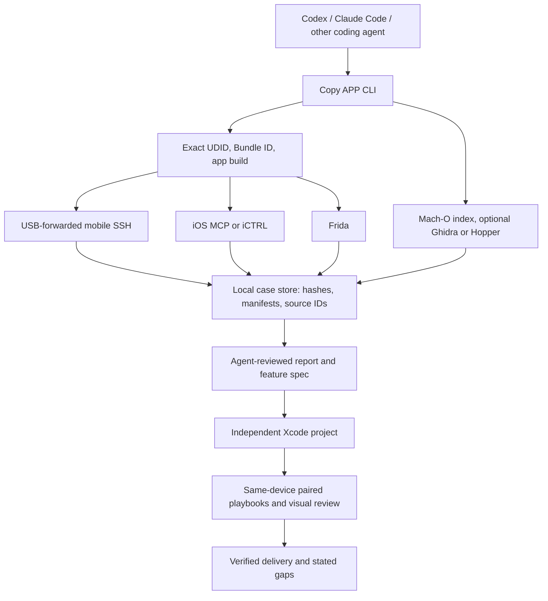

# Architecture and evidence model

[English](architecture.md) · [简体中文](architecture.zh-CN.md) · [Documentation](README.md)

Copy APP has two deliverables: a cited analysis report and an independent iOS app with measured selected-flow coverage. A coding agent supplies semantic interpretation and implementation; the CLI collects, binds and verifies the evidence. The Mac owns orchestration, native analysis and builds. The jailbroken phone supplies installed-app files and bounded observations.

## Component boundaries

| Component | Responsibility | Important limit |
| --- | --- | --- |
| `copyapp` Mac CLI | Capability checks, acquisition, analysis indexes, resumable cases, verification, comparison. | A valid case hash proves saved-byte consistency, not semantic truth. |
| OpenSSH over exact-device USB forward | Acquire installed bundle and bounded sandbox files/metadata. | The SSH host key must be pinned to the selected phone; secrets stay local. |
| iOS MCP tweak | Foreground identity, UI tree, screenshot and gestures in the jailbreak context. | A successful RPC does not prove a rendered result; screenshots and final state are checked. |
| iCTRL XCTest runner | Optional alternative UI backend and launch fallback. | Pairing and DDI are separate prerequisites; iOS 17 multi-step clone reliability has an open transport issue. |
| Frida | Observe selected methods, processes, modules and bounded runtime windows. | Temporal hits do not establish causality or complete implementation. |
| Ghidra / Hopper | Optional pseudocode for hash-pinned native functions. | Decompiled code is an interpretation, not the original source. REA is not a runtime dependency. |
| Agent and reviewer | Choose flows, interpret evidence, write independent code, inspect visual pairs and scope. | The agent must mark unknowns and cannot turn a narrow check into an app-wide claim. |

Only one UI backend sends actions in a given playbook. Original and rebuilt runs use the same backend and declared starting state. UI screenshots, accessibility trees, OCR, file changes and traces are different observations; none silently substitutes for another. A failed or uncertain action remains recorded, and a retry begins only after inspecting the current device state.

## Cases and trust

Commands save manifests, source identities, hashes, raw observations and derived reports under `cases/<case-id>/`. `copyapp verify` checks the case structure and its source links. The `copy` workflow pauses for agent-authored discovery, formal report and independent-app implementation, then verifies each handoff before continuing. Case folders are Git-ignored because they can contain proprietary binaries, screenshots, sandbox data and credentials. Published docs summarize results and limits without embedding those artifacts.

The analysis IPA produced by encrypted-package recovery is for inspection; it is not a signed installable clone. The rebuilt app is an independent Xcode project with its own Bundle ID. `coverage-plan` and `coverage-delivery` keep the known-capability target separate from selected-flow pass counts and unobserved behavior.
