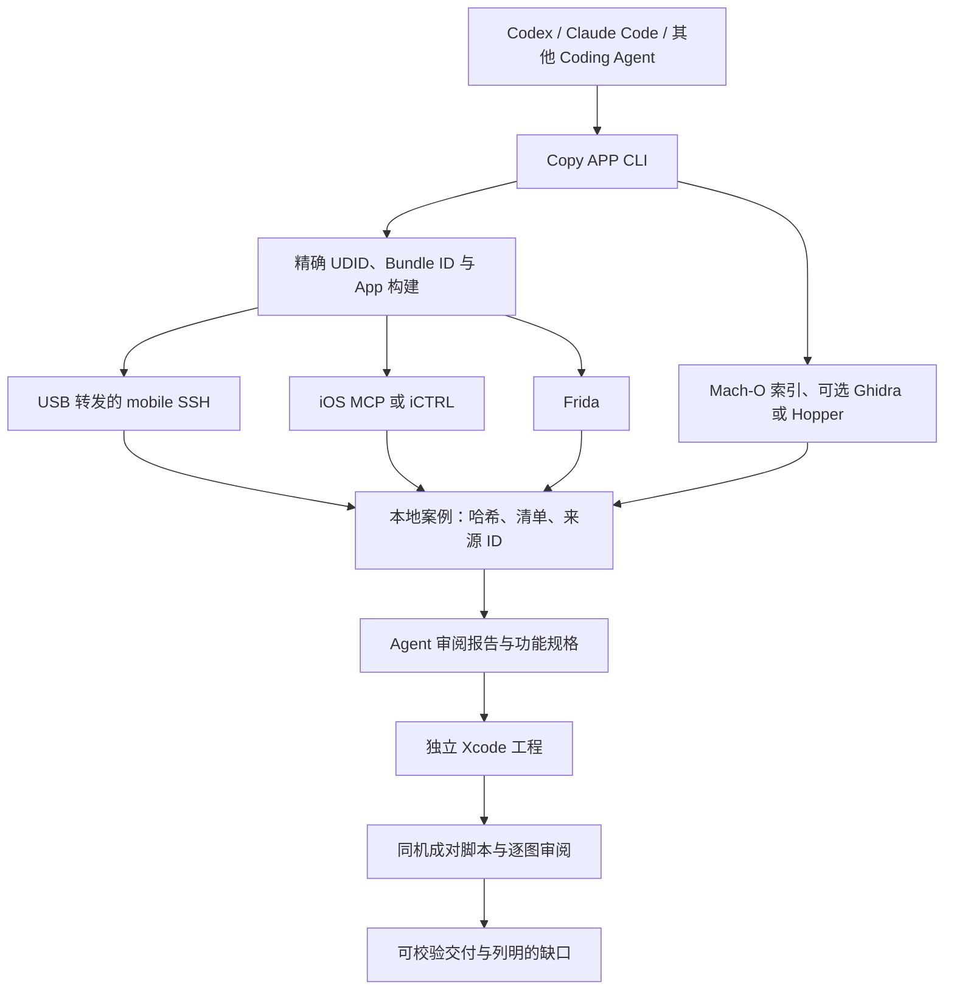

# 架构与证据模型

[English](architecture.md) · 简体中文 · [文档目录](README.zh-CN.md)

Copy APP 有两项交付：带来源引用的分析报告，以及对选定流程给出可测覆盖的独立 iOS App。Coding Agent 负责语义解释与实现；CLI 负责采集、绑定和校验证据。Mac 负责编排、本机代码分析和构建，越狱手机提供已安装 App 文件与有界观察。

## 组件职责

| 组件 | 职责 | 主要边界 |
| --- | --- | --- |
| Mac 端 `copyapp` CLI | 能力检查、采集、分析索引、可续跑案例、校验和对照。 | 案例哈希正确只证明保存字节一致，不证明语义解释正确。 |
| 经精确设备 USB 转发的 OpenSSH | 采集已安装包和有界沙盒文件／元数据。 | SSH 主机密钥需绑定所选手机，凭据留在本地。 |
| iOS MCP tweak | 越狱环境下的前台身份、UI 树、截图和手势。 | RPC 成功不等于画面成功；需检查截图与末端状态。 |
| iCTRL XCTest runner | 可选界面后端及启动回退。 | 配对与开发者镜像是独立前提；iOS 17 复刻版多步传输仍有故障。 |
| Frida | 观察选定方法、进程、模块和有界运行窗口。 | 时间上命中不等于因果关系或完整实现。 |
| Ghidra／Hopper | 对哈希固定的原生函数提供可选伪代码。 | 反编译代码是解释，不是原作者源码；运行时不依赖 REA。 |
| Agent 与审阅者 | 选择流程、解释证据、写独立代码、逐图检查和确定范围。 | 必须标注未知项，不得把窄范围通过说成整 App 等价。 |

一个 playbook 中只有一个界面后端发送操作。原版与复刻版应使用同一后端，并声明可比的起始状态。截图、无障碍树、OCR、文件变化和轨迹属于不同观察，不能互相悄然替代。失败或结果不明的操作要保留记录；重试前先检查设备当前状态。

## 案例与信任边界

命令把清单、来源身份、哈希、原始观察和派生报告写入 `cases/<case-id>/`。`copyapp verify` 核对案例结构与来源引用。`copy` 流程在 Agent 撰写发现脚本、正式报告和独立实现时暂停，并在每次续跑前校验交付。案例目录可能包含第三方二进制、截图、沙盒数据和凭据，因此被 Git 忽略。公开文档只总结结果与限制，不嵌入原始资源。

恢复加密包得到的分析 IPA 用于研究，不是可安装的签名复刻版。复刻版是拥有独立 Bundle ID 的 Xcode 工程。`coverage-plan` 与 `coverage-delivery` 把已知能力目标、选定流程通过率和未观察行为分开。
