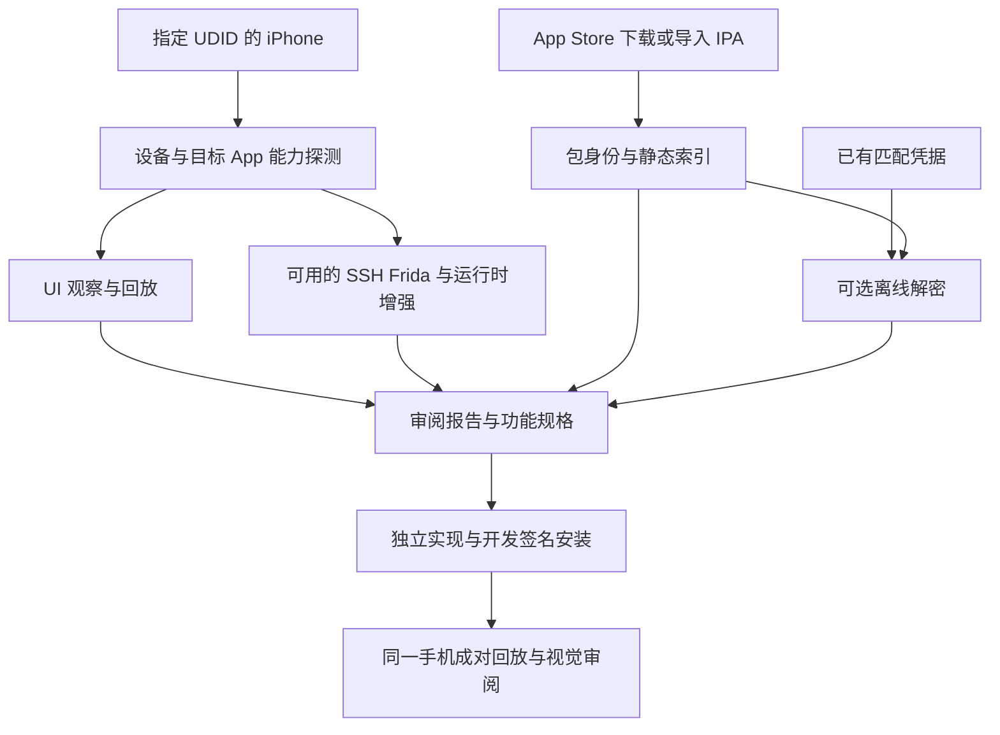

# 普通 iPhone 与越狱 iPhone 支持方案

[文档目录](README.zh-CN.md) · [当前能力](current-status.zh-CN.md) · [现有架构](architecture.zh-CN.md)

状态：当前约定的开发与测试范围已完成，2026-10-23；[当前使用与边界](ios-standard-mode.zh-CN.md) · [验收账本](ios-device-support-acceptance.md)。P0 动作清单与 P1 单一计算器流程已在 iPhone 11／iOS 26.0.1 越狱未激活状态下完成，不能等同于从未越狱设备验收。真实账号下载 FocusTodo、两条普通 UI 流程、iOS 17.3.1 的新增强采集／方法跟踪、第二命名系统的显式普通模式以及 Mac 既有编辑器回归已经通过。iOS 17 的 Frida 子进程为 UID 501，但 RootHide 的 mobile SSH helper 已实测恢复 Remoboard 主程序和键盘扩展，完整 enhanced --decrypt 入口通过；新检查按 helper 路线判断，普通 rootless 路线仍要求 root Frida。用户已将真实凭据准备、无手机连接的离线恢复及独立代码交叉核对移至 [TODO](../TODO.md)，后续另行执行；这些项仍未验证，不计为通过。用户已明确免除“从未越狱设备实测”这一必验项；现有设备状态说明保留，不再因此阻塞本目标。

Copy APP 将普通 iPhone 作为基础入口：观察原 App、整理可验证的功能规格、独立实现、签名安装，再在同一手机上比较选定流程。越狱 iPhone 在此基础上提供安装包和沙盒采集、设备端解密、运行时视图与函数跟踪。安装包和离线解密凭据作为独立输入，不与手机是否越狱绑定。

首个交付目标是普通手机上的一个完整选定流程闭环。没有原包、没有解密凭据、没有 SSH 或 Frida，都不应阻断这个基础目标。重建范围仍按[覆盖目标](coverage-targets.zh-CN.md)和[保真度里程碑](fidelity.md)冻结；不承诺任意 App 的完整复制。

## 用户路径

| 路径 | 必要输入 | 可交付内容 | 边界 |
| --- | --- | --- | --- |
| 普通手机基础路径 | 配对手机、已安装原 App、可运行的 UI 自动化后端、重建签名环境 | UI 与交互报告、功能规格、独立源码、已安装 App、选定流程比较和视觉审阅 | 不要求原包；不声明原 App 函数语义、私有沙盒或服务端实现 |
| 普通手机加安装包 | 基础路径，以及来源明确的 IPA | 增加包身份、权限声明、资源与库索引；有可信解密代码时可增加函数分析 | 包的分析状态与 UI 观察状态分别记录 |
| 越狱手机增强路径 | 基础路径，以及分别探测通过的 SSH、Frida 或 iOS MCP 等能力 | 按实际能力增加包与沙盒采集、设备端代码恢复、运行时结构、方法跟踪和函数证据 | 越狱标记不等于所有能力可用；每项增强单独验收 |

开发者模式、有效的 runner 签名、设备信任和匹配的开发服务，是普通手机自动化的前置条件。手动截图或录屏可以作为明确标注的补充材料；没有可回放后端时，只能交付观察材料和待验证原型，不能宣称自动化比较已通过。[Appium 真机配置说明](https://appium.github.io/appium-xcuitest-driver/latest/getting-started/device-setup/)

## 设备能力与包能力分开建模

设备负责观察和执行，主机负责分析与构建。能力选择基于本次探测和目标操作，不基于一个全局的“已越狱”布尔值。

| 能力 | 普通手机 | 越狱增强 | 实现原则 |
| --- | --- | --- | --- |
| USB 身份与已安装 App 元数据 | 探测配对服务实际返回内容 | 相同 | 固定 UDID、Bundle ID、系统和构建；字段缺失不猜测 |
| 截图、点击、输入、滑动与可访问性树 | 开发签名的 XCTest 后端，需实测 | 可选 iCTRL 或 iOS MCP | 一次回放只由一个后端发送动作 |
| UIKit 类与内部视图对象 | 不作为基础能力 | 通过受支持的进程内采集 | 可访问性树与 UIKit 树使用不同证据类型 |
| 原 App 安装目录与私有沙盒 | 不承诺任意读取 | 经身份校验的 SSH 有界采集 | USB 配对或 DVT 可用不等于拥有任意文件权限 |
| App Store 包下载 | 主机上的账号与许可决定 | 相同 | 与目标手机是否越狱无关 |
| 离线解密 | 已有匹配凭据和受支持格式时可用 | 相同 | 独立主机能力，不标记为普通手机提取能力 |
| 首次获取 FairPlay 凭据 | 基础路径不提供 | 可选的独立准备任务 | 当前上游要求受支持的越狱设备和对应账号的已安装 App |
| 原 App 方法、寄存器与回调跟踪 | 不作为任意商店 App 的基础能力 | 经精确目标校验的 Frida | 自有开发 App 的调试能力不能推导为任意原 App 可附加 |
| 网络观察 | 可观察的行为、错误与受支持的元数据 | 可增加有界运行时观察 | 不默认取得 HTTPS 明文、原服务身份或服务端逻辑 |
| 重建安装与运行 | 开发签名和 USB 安装 | 可选已有 TrollStore 路径 | 原 App 解密包与独立重建的安装包分别存证 |

建议对每项能力记录 `available`、`unavailable`、`not_configured`、`not_probed`、`failed`，以及提供方、作用对象、前置条件、探测时间、源证据和原因。连接失效或恢复会话后，重新探测所需能力；历史成功不能代替当前连接身份。

## 普通手机基础闭环

1. **识别目标。** 列出已连接手机和可见 App，固定精确 UDID 与 Bundle ID。多手机时必须唯一选择；记录屏幕尺寸、系统、语言、文字大小及可获得的版本和构建。
2. **准备 UI 后端。** 优先验证现有 iCTRL 的开发签名、USB 安装和 XCTest 会话路径能否在普通手机工作。验证失败时保留原因，再评估 WDA/XCUITest 适配；首个版本不同时维护两个新的默认后端。普通路径不进入 SSH、TrollStore 或 tweak 安装修复。
3. **发现代表流程。** Agent 观察原 App，保存有起始状态、动作、截图检查点和最终行为断言的有界 playbook。复用现有流程格式和 `discover-check` 的适用规则；新增后端必须通过同样的动作和断言契约。
4. **审阅规格。** 依据 UI 证据编写行为报告与 `feature-spec.json`，保留流程脚本哈希。持久化通过退出重启后观察验证；没有私有数据证据时，不写成已知数据库结构。
5. **独立实现。** 冻结已知能力清单、选定范围和保真度目标，构建自有 Bundle ID 的 App，通过有效开发签名安装。没有签名条件时可以交付源码和构建诊断，设备交付仍标记未完成。
6. **成对验收。** 在同一手机、同一后端及等价起始状态下执行原版和重建版，验证每个选定流程的行为断言并审阅全部截图对。沿用现有保真度停止规则；严格交付仍要求其原有完整条件。

普通路径报告明确分为“直接观察”“推断”“未知”。UI 证据可以支持用户行为规格；函数结论仍必须有对应代码和推理依据。没有函数证据时，不把基础报告包装成深度函数报告。

若原 App 使用账号、云服务或不可访问的付费状态，在能力清单中保留这些依赖。独立实现若使用自有服务或模拟数据，应在相关能力和最终交付中标明，不能据此认定原服务等价。

## 可选安装包与离线代码分析

`ipatool` 提供商店包获取入口，用户也可导入已有 IPA。下载固定工具版本或 commit，并保存 Bundle ID、商店、请求版本、实际版本与构建、平台、时间、包哈希及来源类型。工具当前不支持购买付费 App；付费目标需要先拥有许可，下载和历史版本供应仍由服务端决定。[下载接口](https://github.com/majd/ipatool/blob/main/cmd/download.go)、[许可获取实现](https://github.com/majd/ipatool/blob/main/pkg/appstore/appstore_purchase.go)

没有凭据时，继续提供资源、元数据和可读取部分的索引；加密函数保留为不可分析。已有匹配 credential 时，可选调用固定版本的 `fairplay-decrypt`。当前支持范围包括 ARM64、SUPF v3/v5 和特定 SINF 记录格式；首次取得 credential 仍依赖上游支持的越狱设备。凭据准备与普通手机任务分开，不把它设为基础闭环的隐含前置条件。[格式范围](https://github.com/EthanArbuckle/fairplay-decrypt#readme)、[凭据前置条件](https://github.com/EthanArbuckle/fairplay-decrypt/blob/main/credential-retrieval/README.md)

解密结果至少经过以下独立检查：

- 先索引输入包的全部 Mach-O 与架构，再与工具实际处理列表比较，发现漏掉的加密程序或不支持的切片；部分成功不能写成整包成功。上游入口按 SUPF 建立处理列表，不能仅凭退出码判断包级完整性。[解密入口](https://github.com/EthanArbuckle/fairplay-decrypt/blob/main/decrypt.py)
- 校验包成员、二进制长度与 UUID，并审计变更是否仅发生在允许的加密区域和加密标记；未涉及资源保持一致。支持范围与现有 thin ARM64 审计不一致时明确拒绝或标记部分结果，不能跳过检查。
- 检查输出全部相关 Mach-O 的加密标记。标记清零与字节变更只说明结构条件成立，不能单独证明明文正确。记录解密字节可信度；正式验证样本应与精确匹配构建的设备恢复代码或独立运行证据交叉核对。
- 保留输入输出哈希、工具版本、命令的脱敏参数、每个程序的结果和失败原因。输出为分析包，不直接作为已签名可安装 App。

凭据只从本地忽略的凭据存储通过不透明引用读取，不进入任务正文、报告、日志或 Git；账号会话、下载地址中的令牌及 SINF 也按敏感材料管理。上游工具的 root SSH、单设备假设不能直接绕过本项目的精确 UDID、端口和主机密钥校验；不支持当前设备路由时报告缺失条件。

## 包证据与手机观察的关联

包下载与 UI 采集可以发生在不同时间、不同设备。为每个来源保留自己的身份和时间，避免把离线代码、旧手机跟踪和新手机界面写成同一观察窗口。

| 关联程度 | 允许的结论 |
| --- | --- |
| 只有 Bundle ID 相同 | 同一产品线索，不能关联具体版本函数 |
| 版本和构建相同 | 元数据相符；设备变体和架构仍可能不同 |
| 相关架构、Mach-O UUID 与代码身份进一步核对 | 按实际匹配范围引用代码，声明核对方法 |
| 原始入口与实际加载模块绑定，并有对应步骤的运行命中 | 可以支持该设备、构建和观察窗口的运行结论，仍不能仅凭时间重合断言因果 |

普通手机无法取得足够二进制身份时，保留“商店包静态结论”和“手机 UI 观察”两条证据线，明确关联强度。旧版本包可以作为研究线索，不能替代新版本的函数证据。跨设备补充材料不能冒充现有同设备报告合并或严格交付。

## CLI 与证据模型改造

下表保留设计目标；已落地的显式模式、包适配器与使用方法见[开发分支说明](ios-standard-mode.zh-CN.md)，其余验收条件不因新增命令而自动通过。

设备操作继续使用显式 `--udid` 和 `--bundle`。拟加入 `--mode auto|standard|enhanced`：`standard` 的基础任务不执行越狱专用采集；`enhanced` 依据请求操作检查所需增强能力；`auto` 只选择已探测可用的路线。用户要求函数跟踪而能力缺失时，返回具体阻塞原因，不静默换成 UI 成功。

| 模块 | 当前约束 | 拟议修改 |
| --- | --- | --- |
| [onboarding](../copyapp/onboarding.py) 与 [doctor](../copyapp/doctor.py) | 分析与重建就绪条件绑定 SSH、Frida、iOS MCP | 按任务检查 UI 观察、包分析、运行跟踪和签名交付所需能力；区分主机工具就绪与设备闭环就绪 |
| [UI 后端](../copyapp/ictrl_setup.py) | 有 USB 安装和 XCTest 路径，但普通手机尚需命名设备验证 | 增加明确的普通设备路线和签名诊断，复用会话保活、动作完成未知及清理逻辑 |
| [分析编排](../copyapp/analyze.py) | 原包、沙盒与解密采集面向 SSH 工作流 | 新编排将 UI 设为基础阶段，包和运行证据设为可选阶段，记录缺失项及恢复点 |
| 商店获取与离线恢复 | 尚未接入两个上游工具 | 独立适配器与 case 类型；固定工具身份、来源与脱敏记录，不复用设备端恢复的成功身份 |
| [报告](../copyapp/report.py) 与功能规格 | 现有来源校验依赖采集 case 及其原包 | 增加 UI 行为报告和独立包来源的明确契约；未观测的函数、沙盒、网络字段允许带理由缺失 |
| [校验](../copyapp/verify.py) 与交付 | 历史 case 有固定来源和严格门槛 | 新增显式版本或 case kind 分派；旧 v1 校验语义、来源绑定及严格交付规则保持原样 |

新 case 格式应包含：实际执行模式、能力探测来源、设备/App 身份、每阶段状态、包来源、UI 后端、输入脚本哈希、缺失证据、结论适用范围和恢复记录。具体 schema 在 P0/P1 固定，格式版本升级不能自动给旧证据补出新能力。

流程阶段使用 `complete`、`skipped_optional`、`blocked`、`failed` 等明确状态。阶段完成、任务目标完成与整体交付分别判断：基础任务可在明确跳过可选增强后完成；深度任务缺少必需函数证据则仍阻塞。无法确认 tap 是否执行时，先观察当前状态，再决定恢复动作，不自动重发。

## 实施顺序与验收

| 阶段 | 交付范围 | 必须通过的验收 |
| --- | --- | --- |
| P0 普通手机可行性 | 固定一台未越狱真机；验证已有 iCTRL 的开发签名路线，必要时再选 WDA | 记录精确设备、iOS、Xcode、签名与 runner 版本；无 SSH、Frida、TrollStore，完成身份核对、启动、截图、树、点击、输入、滑动、断言、会话结束和退出清理；至少覆盖一个非自有 App 的可访问流程 |
| P1 基础分析到重建 | 能力探测、新编排、UI 报告、新 case 校验和签名安装闭环 | 未提供 IPA 或 credential 时，完成一个独立重建和同机成对比较；审阅全部截图并按既定目标交付；缺少签名、runner 失效、身份不符和动作回复丢失有明确失败或恢复结果 |
| P2 商店包与离线分析 | `ipatool` 下载、IPA 导入、可选离线恢复、静态证据绑定 | 分别验证无凭据、有效凭据、错误凭据、主程序及扩展、格式不支持、残留加密程序、包版本不符；为可比的精确构建交叉核对恢复代码；在断开越狱设备后完成一次使用已有凭据的离线恢复 |
| P3 越狱增强与组合 | 原包和沙盒采集、设备端恢复、Frida/运行时证据接入新编排 | 原有命名设备回归；基础 UI 任务在增强不可用时仍可完成，明确请求的深度操作则准确阻塞；跨设备、跨构建证据混入被拒绝 |
| P4 兼容性与发布 | 引导、技能和双语说明；旧新格式兼容；独立安装包检查 | 第二台普通手机或另一个明确系统组合的回归；旧 v1 成功、失败及篡改样本仍按原规则校验；按能力公布命名设备支持范围 |

用户已明确延后 P2 中的真实凭据提取、离线解密正例和交叉核对，见 [TODO](../TODO.md)；其余已实现和实测范围按本轮交付收尾。P1 的普通手机闭环是首个产品里程碑，P2 不阻塞它。P0 若现有 iCTRL 路线不可行，先固定替代后端及其依赖，再推进 P1；不能用越狱手机上的 XCTest 成功代替 P0。

实施中的代码检查应覆盖能力路由、阶段恢复、身份绑定、脱敏、格式升级和旧校验回归。真实设备验收分别保存原版、重建版、安装、比较、视觉审阅及交付 case，并对每个 case 执行 `.venv/bin/copyapp verify`。不为规划文档本身创建虚构设备 case。

## 交付口径与支持边界

每次交付分别说明观察依据、可用代码证据、选定功能、已验证结果、缺失与未知项，以及测试手机和构建。已知能力覆盖率、选定流程通过率和保真度评分分别报告；没有能力清单分母时，只报告具名范围。

本方案扩展 iOS 路径。macOS 继续使用独立的 `copyapp mac` 命令和 ChatComputer 环境身份；`ipatool` 能下载 macOS PKG 不构成 iOS 离线解密路线已支持 Mac App 的证据。

当前能力以[已发布状态](current-status.zh-CN.md)为准。普通手机支持、商店获取和离线解密须分别通过上述验收后，才能加入支持列表。
